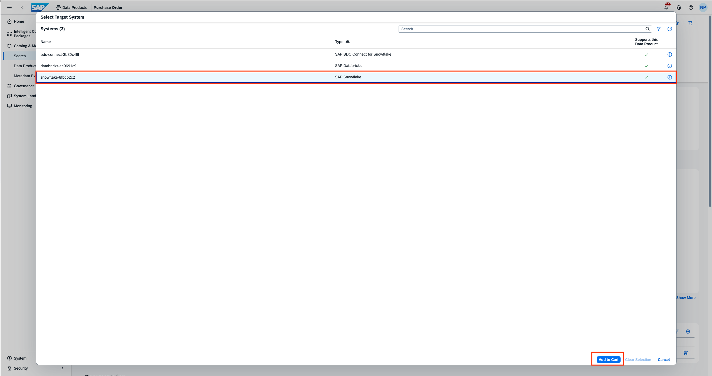
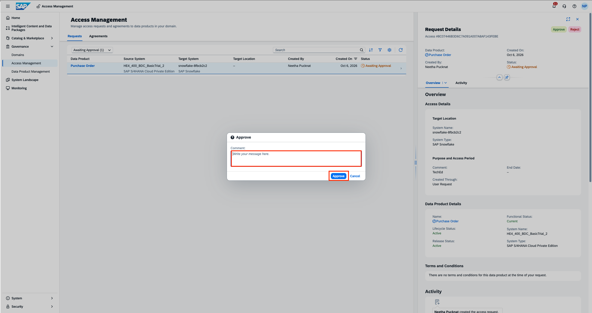
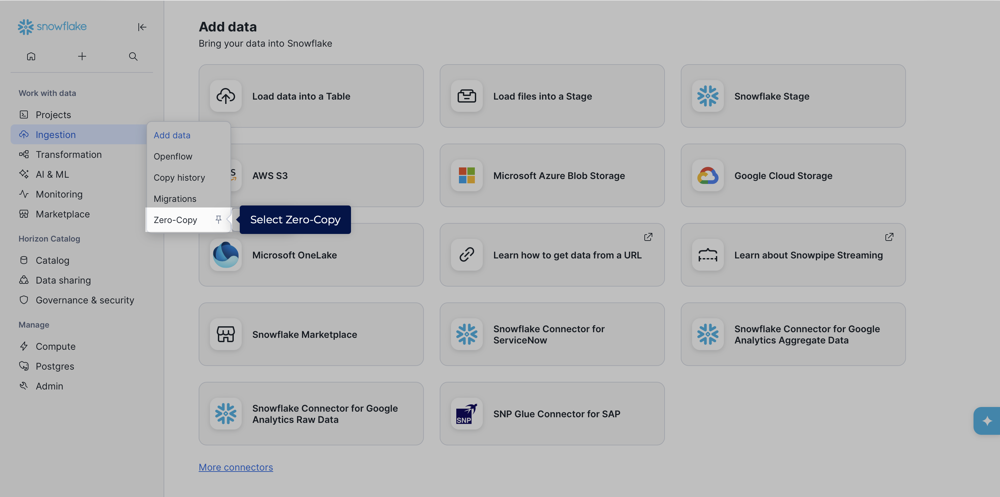
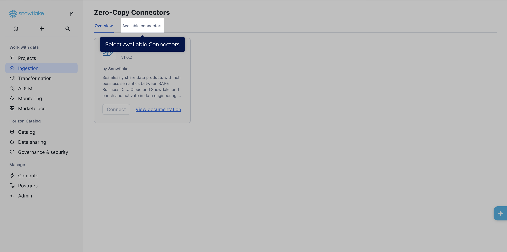
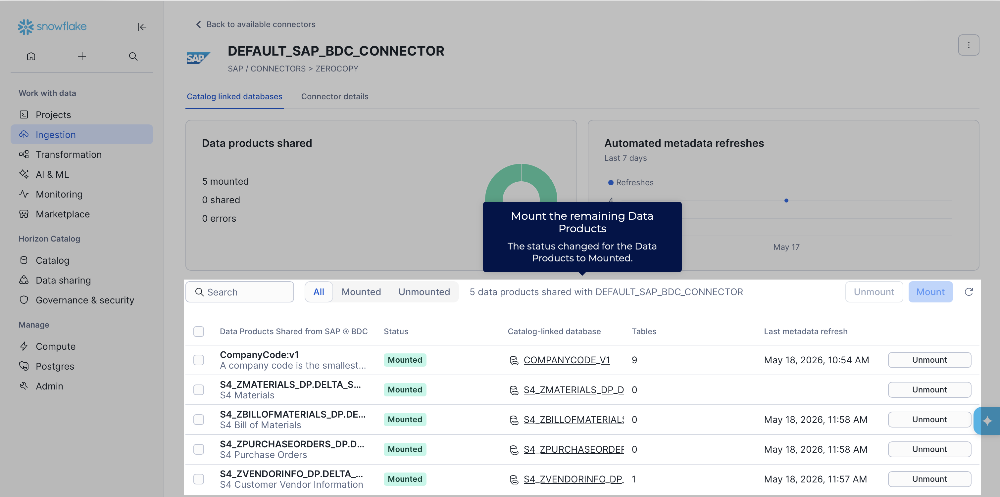
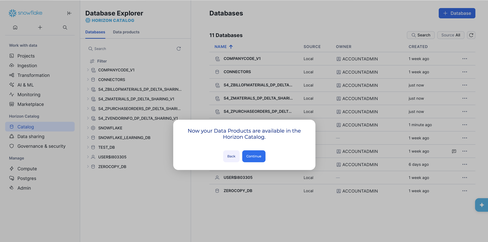

# Exercise 1 - READ-ONLY, GUIDED TOUR: Install SAP-managed Data products into SAP Snowflake Horizon Catalog

> [!IMPORTANT]
> This is only a **read-only** exercise, since installing data products from SAP Business Data Cloud into the Snowflake horizon catalog is a one-time activity. The purpose is to illustrate the zero-copy data sharing principle, to get easy access to SAP managed and standardized data product economy. There is a product guided tour available below.

This chapter describes the steps how Data Products in SAP Business Data Cloud (SAP BDC) are installed within SAP Snowflake. As a pre-requisite, the [SAP Snowflake](https://help.sap.com/docs/business-data-cloud/administering-sap-business-data-cloud/provisioning-sap-snowflake) must be provisioned. Once active, the SAP Snowflake account is ready for you to share data products from SAP BDC to SAP Snowflake. As part of the provisioning process for a new SAP Snowflake account, the system automatically creates a zero-copy connector called DEFAULT_SAP_BDC_CONNECTOR and enrolls it with SAP BDC in the SAP Snowflake account. The BDC Connect component is a dedicated, integrated environment for advanced data processing within SAP BDC. This process assigns resources, configures identity authentication, and defines key system parameters so that supported external systems are ready for use. In the above scenario with SAP Snowflake, the component is implicit and does not need to be provisioned.

#### Prequisites
- You have an BDC system landscape formation with **SAP SuccessFactors**. 
- You need to have a SAP BDC Admin role for sharing
- Following Data Products are already installed and available in the SAP Business Data Cloud catalog:

| # | Data Package | Data Product |
|---|---|---|
| 1 | SAP SuccessFactors Learning Data Products | LearningEventHistory |
| 2 | SAP SuccessFactors Succession and Career Development Data Products | CareerDevelopmentPlanningData |
| 3 | SAP SuccessFactors Succession and Career Development Data Products | DevelopmentGoals |
| 4 | SAP SuccessFactors Succession and Career Development Data Products | SuccessionManagement |
| 5 | SAP SuccessFactors Succession and Career Development Data Products | SuccessionReadiness |
| 6 | SAP SuccessFactors Performance and Goals Data Products | PerformanceReviews |
| 7 | SAP SuccessFactors Performance and Goals Data Products | PerformanceRatingStandard |
| 8 | SAP SuccessFactors Skills Data Products | WorkforceSkillsData |
| 9 | SAP SuccessFactors Employee Central Data Products | WorkforcePerson |

#### Guided Tour
1. Use the Clickthrough below to get an impression of Installing data product from SAP BDC Catalog into SAP Snowflake.

2. Use the clickthrough below to get an impression of mounting data product tables on SAP Snowflake

#### Exercise (READ-ONLY)
##### Install data products from SAP BDC Catalog into SAP Snowflake catalog: Create Access Request by Analyst role
For the mentioned nine data products, install each of the data products to SAP Snowflake by following the steps below for each of them.
1. Open **Catalog & Marketplace** > **Search** and search the name of the data product.
 

2. Open the data product to be installed and click on **Add to Cart**.
 

3. Select the target system where you want to install the data product. Click on **Add to Cart**.
 

4. Click on the cart and then click **Proceed**.
 

5. Add a comment for the Adminstrator/ Data Steward. Then accept the **Terms and Conditions**. Click on **Send** to create and send the Access request.
 
 

##### Install data products from SAP BDC Catalog into SAP Snowflake catalog: Approve Access Request by Data steward/Administrator role
1. Administrator/ Data Steward receives a notification for the access request.
 

2. The access request can be viewed either by clicking on the notification or can be viewed under **Governance > Access Management**
 

3. The request can be approved or rejected as per policy by the Administration or Data Steward.
 

4. An approval comment can be added and then click on **Approve**.
 

##### Install data products from SAP BDC Catalog into SAP Snowflake catalog: Finish Install by Requester
1. The request recives a notification that the access request has been approved.
 

2. Notification can be viewed or the approval can also be accessed under  **Catalog > Data Product Access**.
 

3. Click on **Install Data Product** to finish the installation into Snowflake.
 

##### Create catalog-linked databases for the zero-copy shared data products in SAP Snowflake
1. Open SAP Snowflake from the **System Landscape** tab.

2. Select **Ingestion** tab to view the shared data products from SAP BDC Catalog
 

3. Select **Zero-Copy** tab since the data is shared without replication
 

4. Select **Available connectors** to find the zero copy BDC Connector
 

5. Select the zero copy connector which has been created during setup.
 

6. Mount the shared data tables that were shared from the SAP BDC Catalog.
 

7. Once mounted, the data products are ready for consumption in SAP Snowflake.
 

8. You can view the mounted databases in the Horizon catalog.
 

## Summary

You've now learnt how to share data products to SAP Snowflake and mount data tables. Let us now continue to [Exercise 2 - Consume SAP-managed Data product in Enterprise Snowflake and run ML Workflows](../ex2/README.md)

