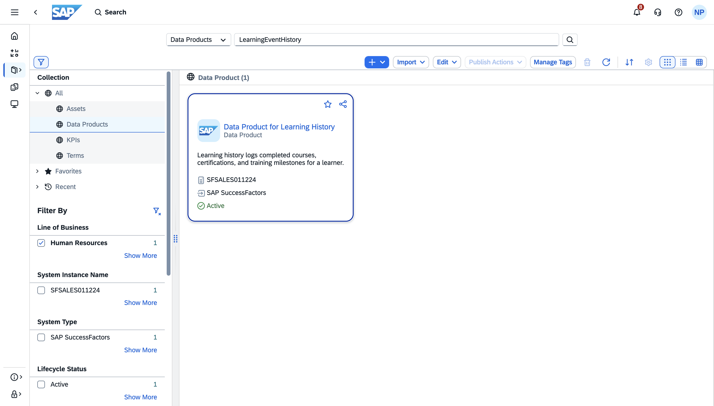
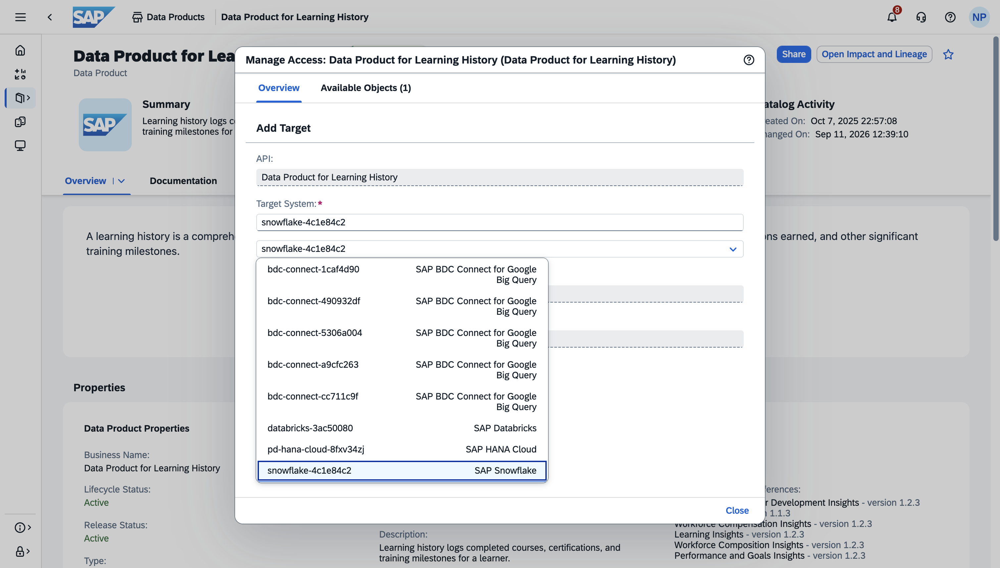
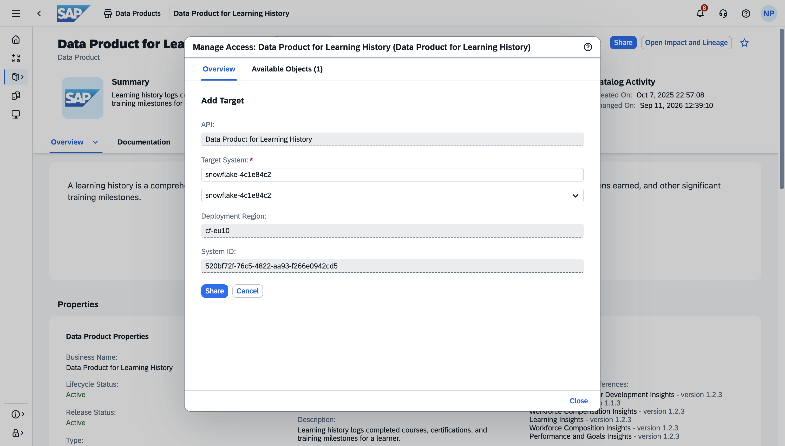

# Exercise 1 - READ-ONLY, GUIDED TOUR: Share SAP-managed Data products from SAP BDC Catalog to SAP Snowflake Horizon Catalog

> [!IMPORTANT]
> This is only a **read-only** exercise, since sharing data products in SAP Business Data Cloud requires ADMIN rights. The purpose is to illustrate the zero-copy data sharing principle, to get easy access to SAP managed and standardized data product economy. There is a product guided tour available below.

This chapter describes the steps how Data Products in SAP Business Data Cloud (SAP BDC) are shared with SAP Snowflake. As a pre-requisite, the [SAP Snowflake](https://help.sap.com/docs/business-data-cloud/administering-sap-business-data-cloud/provisioning-sap-snowflake) must be provisioned. Once active, the SAP Snowflake account is ready for you to share data products from SAP BDC to SAP Snowflake. As part of the provisioning process for a new SAP Snowflake account, the system automatically creates a zero-copy connector called DEFAULT_SAP_BDC_CONNECTOR and enrolls it with SAP BDC in the SAP Snowflake account. The BDC Connect component is a dedicated, integrated environment for advanced data processing within SAP BDC. This process assigns resources, configures identity authentication, and defines key system parameters so that supported external systems are ready for use. In the above scenario with SAP Snowflake, the component is implicit and does not need to be provisioned.

#### Prequisites
- You have an BDC system landscape formation with **SAP SuccessFactors**. 
- You need to have a SAP BDC Admin role for sharing
- Following Data Products are already installed and available in the SAP Business Data Cloud catalog:

| # | Data Package | Data Product |
|---|---|---|
| 1 | SAP SuccessFactors Learning Data Products | LearningEventHistory |
| 2 | SAP SuccessFactors Succession and Career Development Data Products | CareerDevelopmentPlanningData |
| 3 | SAP SuccessFactors Succession and Career Development Data Products | DevelopmentGoals |
| 4 | SAP SuccessFactors Succession and Career Development Data Products | SuccessionManagement |
| 5 | SAP SuccessFactors Succession and Career Development Data Products | SuccessionReadiness |
| 6 | SAP SuccessFactors Performance and Goals Data Products | PerformanceReviews |
| 7 | SAP SuccessFactors Performance and Goals Data Products | PerformanceRatingStandard |
| 8 | SAP SuccessFactors Skills Data Products | WorkforceSkillsData |
| 9 | SAP SuccessFactors Employee Central Data Products | WorkforcePerson |

#### Guided Tour
1. Use the clickthrough below to get an impression of sharing data products to SAP Snowflake. Click the button below to launch the interactive prototype.

2. Use the clickthrough below to get an impression of mounting data product tables on SAP Snowflake

#### Exercise (READ-ONLY)
##### Share data products from SAP BDC Catalog to SAP Snowflake catalog
For the mentioned nine data products, share each of the data products to SAP Snowflake by following the steps below for each of them.
1. Login to SAP Business Data Cloud Cockpit and click on `Search` to navigate to the Data Catalog.
 

2. In the catalog search view, click the Data Products tab in the filter bar to narrow the results to data products only.
 

3. Search for the data product by name and using the filters.
 

4. View the details of the data product. Then, use **Share** button and add target to share with. 
 

5. In this case, our desired target is SAP Snowflake.
 

6. Create the share using the Share button
 

##### Create catalog-linked databases for the zero-copy shared data products in SAP Snowflake
1. Open SAP Snowflake from the **System Landscape** tab.

2. Select **Ingestion** tab to view the shared data products from SAP BDC Catalog
 

3. Select **Zero-Copy** tab since the data is shared without replication
 

4. Select **Available connectors** to find the zero copy BDC Connector
 

5. Select the zero copy connector which has been created during setup.
 

6. Mount the shared data tables that were shared from the SAP BDC Catalog.
 

7. Once mounted, the data products are ready for consumption in SAP Snowflake.
 

8. You can view the mounted databases in the Horizon catalog.
 

## Summary

You've now learnt how to share data products to SAP Snowflake and mount data tables. Let us now continue to [Exercise 2 - Consume SAP-managed Data product in Enterprise Snowflake and run ML Workflows](../ex2/README.md)

