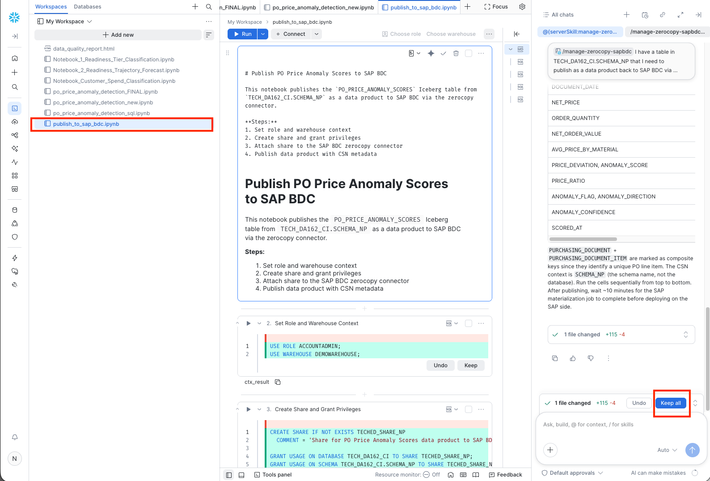

# Exercise 3- HANDS-ON: Create and publish custom derived data product in Enterprise Snowflake using CoCo Agent

We will use the CoCo agent for the creation of the data product to be published on the SAP BDC Catalog. In Snowflake, you can access CoCo as shown below. You can create a data product using prompts.

<br>

For Snowflake, we have out-of-the-box Cortex Code skills included to package and publish a custom data product. To create a data product to publish to BDC, use `/manage-zerocopy-sapbdc`. The full documentation can be found [here](https://docs.snowflake.com/en/user-guide/data-integration/zero-copy/sap-sql/publish-data)

Here is the prompt, please adjust the your name object names and the name of the data product that you want to publish:
<SCHEMANAME>: SCHEMA_<YOUR USERNAME>
<SHARENAME> : TECHED_DA261_SHARE_<YOUR USERNAME>
<USERNAME>: YOUR_USERNAME

```
/manage-zerocopy-sapbdc I have 12 tables in TECHED_DA261.<SCHEMANAME> that I need to publish as a data product back to SAP BDC via the zerocopy connector. Use all the tables in TECHED_DA261.<SCHEMANAME>

The tables are already ICEBERG VERSION=3 with the following configuration activated: ICEBERG_VERSION = 3 CATALOG = 'SNOWFLAKE' EXTERNAL_VOLUME = 'SNOWFLAKE_MANAGED' STORAGE_SERIALIZATION_POLICY = 'COMPATIBLE' ENABLE_ICEBERG_MERGE_ON_READ = FALSE

Create a new notebook that does the following:

Create a share called <SHARENAME> and grant usage on the database/schema plus SELECT on all Iceberg tables within the schema. Attach the share to my existing SAP BDC zerocopy connector at CONNECTORS.ZEROCOPY.DEFAULT_SAP_BDC_CONNECTOR. Wrap it in a BEGIN/EXCEPTION block in case the share is already associated. Publish the data product using SYSTEM$SAP_PUBLISH_DATA_PRODUCT with a minimal CSN (version 1.0 interop, 2.0 schema). Generate the CSN definitions block mapping each table's columns to CDS types, marking key and notNull fields appropriately.
The mapping is as follows:
| Snowflake Type | CDS Type | Notes |
|---|---|---|
| BOOLEAN | `cds.Boolean` | - |
| INTEGER \| INT | `cds.Integer` | - |
| BIGINT | `cds.Integer64` | - |
| NUMBER(p,s) \| DECIMAL(p,s) | `cds.Decimal(p,s)` | Use matching precision and scale. Max precision is 38 |
| FLOAT \| FLOAT4 \| FLOAT8 | `cds.Double` | - |
| REAL \| DOUBLE PRECISION | `cds.Double` | - |
| VARCHAR \| STRING \| TEXT | `cds.String(5000)` | Always declare length 5000 |
| DATE | `cds.Date` | - |
| TIMESTAMP_NTZ(n) | `cds.Timestamp` | - |
| TIMESTAMP_LTZ(n) | `cds.Timestamp` | - |
| TIME(n) | `cds.Timestamp` | - |
| BINARY(n) | Not supported | - |
| VARIANT | Not supported | - |
| OBJECT(...) \| ARRAY(...) \| MAP(...) | Not supported | - |
| GEOMETRY \| GEOGRAPHY | Not supported | - |
"title": "<USERNAME> Workforce Transformation Velocity Intelligence", "shortDescription": "ML-predicted employee readiness tiers and 12-month department learning trajectory vs transformation milestones.", "description": "Combined Snowflake Cortex ML output derived from 8 SAP SuccessFactors data products shared via SAP Business Data Cloud. ML.CLASSIFICATION scores each employee into transformation readiness tiers (READY_NOW, FAST_TRACK_3MO, NEEDS_COACHING, NEEDS_PROGRAM) with a composite velocity index (0-100). ML.FORECAST projects 12-month department-level learning completion trajectories against program milestone gates, classified as ON_TRACK, MARGINAL, POSSIBLE_IF_ACCELERATED, or WILL_MISS."
USE WAREHOUSE SYSTEM$STREAMLIT_NOTEBOOK_WH. Grant all the privileges to the share that are required.
```

Add the above prompt edited with your personalized share name and data product name in the chat as shown below:
<br>

After running the prompt, a notebook is created with the above instructions. Click on "Keep All" to make the necessary changes.
<br>

Run the notebook to create the data product. Once done, <b>it takes about 10 minutes to publish the data product on the SAP BDC Catalog.</b>

> [!NOTE]
> In case, you have issues with generating the notebook, you can find the notebook we have provided and customize it to publish your own data product. The notebook can be found [here](./03_Publish_to_SAP_BDC.ipynb)

## Summary

You've now learnt how to create and publish a custom data product in Snowflake.

Continue to the - [Exercise 4 - Install custom data product in SAP Datasphere](../ex4/README.md) where you will learn how to install data products in SAP Datasphere.