# Exercise 5 - HANDS-ON: Modelling in SAP Datasphere

In this exercise, we will create an integrated data model. We will use the data product published from SAP Snowflake and perform modelling in SAP Datasphere.

## Pre-requisites
- A custom space in SAP Datasphere provided to you named after your username
- Custom, Derived data product has been installed in the space in the previous exercise

## Exercise 
We will first create an integrated Fact view and then create an Analytic model on top of it.
In the Fact, we will create some aggregated KPIs to offer insights to a CHRO.

### Create a Fact View: Department Forecasts
1. Open **Data Builder** in SAP Datasphere (TODO)
<br>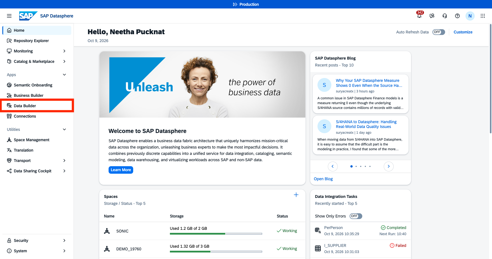

2. Search for the space and open it. Your space will have your username Eg. `ACXXXXXXXXX`
<br>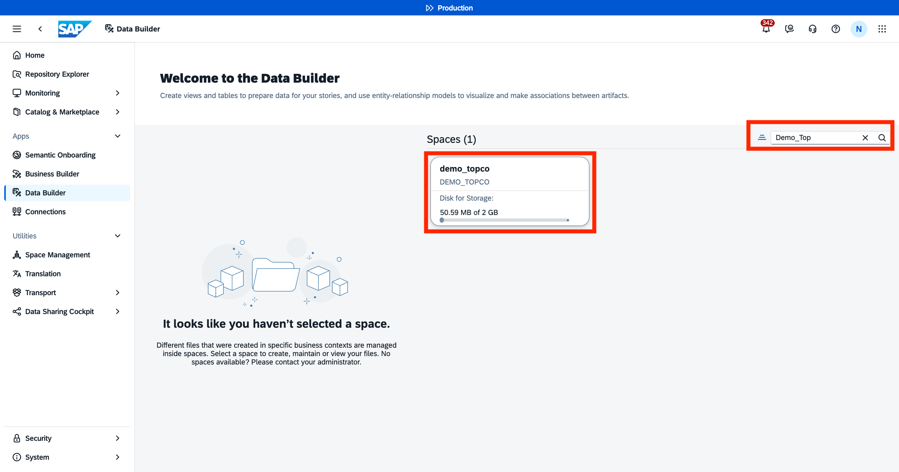

3. Create a new SQL view.
<br>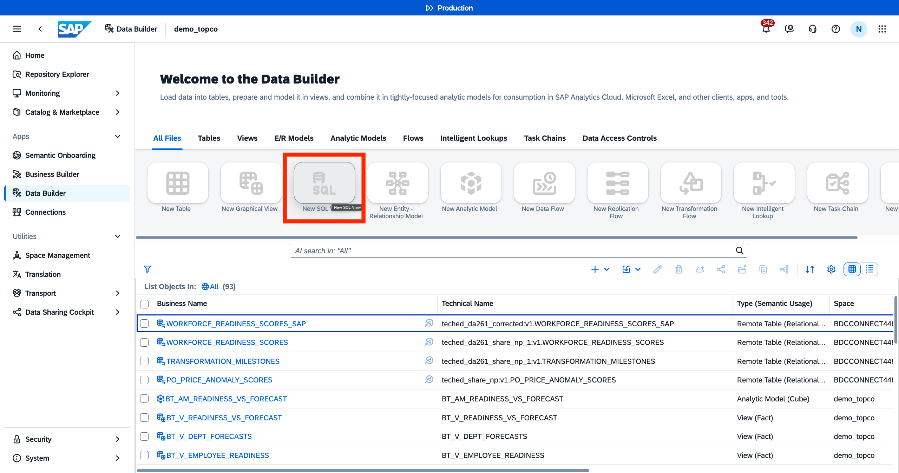

4. This SQL view is department forecast data. It is the department-level target aggregation into one view that summarizes workforce transformation progress by department and milestone status.
Adjust the SQL Query below to add the correct technical name of your data product tables.
```
/* Consolidated Department Forecasts and Targets */

SELECT
    f.DEPARTMENT,
    f.DEPT_MILESTONE_STATUS,

     MAX(
        CAST(f.DEPT_PROJECTED_COMPLETIONS_12MO AS DECIMAL(18, 2))
    ) AS DEPT_PROJECTED_COMPLETIONS_12MO,
        

    SUM(f.FM_REQUIRED_COMPLETIONS)
        AS total_required_completions,

    COUNT(DISTINCT f.FM_MILESTONE_NAME)
        AS milestone_count,

    SUM(f.COMPLETIONS)
        AS actual_completions_to_date,

    SUM(f.ACTIVE_LEARNERS)
        AS total_active_learners,

    ROUND(SUM(f.TOTAL_CREDIT_HOURS), 1)
        AS total_credit_hours

FROM (
    SELECT
        tv.DEPARTMENT,
        tv.DEPT_MILESTONE_STATUS,
        tv.DEPT_PROJECTED_COMPLETIONS_12MO,

        fm.FORECAST_MONTH,
        fm.PROJECTED_COMPLETIONS,
        AVG(fm.LOWER_90) OVER () AS AVG_LOWER_90,
        AVG(fm.UPPER_90) OVER () AS AVG_UPPER_90,
        fm.MILESTONE_NAME AS FM_MILESTONE_NAME,
        fm.REQUIRED_COMPLETIONS AS FM_REQUIRED_COMPLETIONS,
        fm.MILESTONE_STATUS,

        tm.MILESTONE_DATE,
        tm.MILESTONE_NAME AS TM_MILESTONE_NAME,
        tm.REQUIRED_COMPLETIONS AS TM_REQUIRED_COMPLETIONS,

        ms.MONTH_DATE,
        ms.COMPLETIONS,
        ms.ACTIVE_LEARNERS,
        ms.TOTAL_CREDIT_HOURS,

        lr.SERIES,
        lr.TS,
        lr.FORECAST,
        AVG(lr.LOWER_BOUND) OVER () AS AVG_LOWER_BOUND,
        AVG(lr.UPPER_BOUND) OVER () AS AVG_UPPER_BOUND

    FROM "SNOWFLAKE8FBCB2C2.da261_share:v1.WORKFORCE_TRANSFORMATION_VELOCITY" tv

    LEFT JOIN "SNOWFLAKE8FBCB2C2.da261_share:v1.FORECAST_VS_MILESTONES_SAP" fm
        ON TO_VARCHAR(tv.DEPARTMENT) = TO_VARCHAR(fm.DEPARTMENT)

    LEFT JOIN "SNOWFLAKE8FBCB2C2.da261_share:v1.TRANSFORMATION_MILESTONES" tm
        ON tv.DEPARTMENT = tm.DEPARTMENT

    LEFT JOIN "SNOWFLAKE8FBCB2C2.da261_share:v1.VW_LEARNING_MONTHLY_SERIES" ms
        ON tv.DEPARTMENT = ms.DEPARTMENT

    LEFT JOIN "SNOWFLAKE8FBCB2C2.da261_share:v1.LEARNING_FORECAST_RAW_SAP" lr
        ON tv.DEPARTMENT = lr.SERIES
) f

GROUP BY
    f.DEPARTMENT,
    f.DEPT_MILESTONE_STATUS
```
5. Validate the SQL and preview the results. Change configuration of the SQL view before saving.
<br>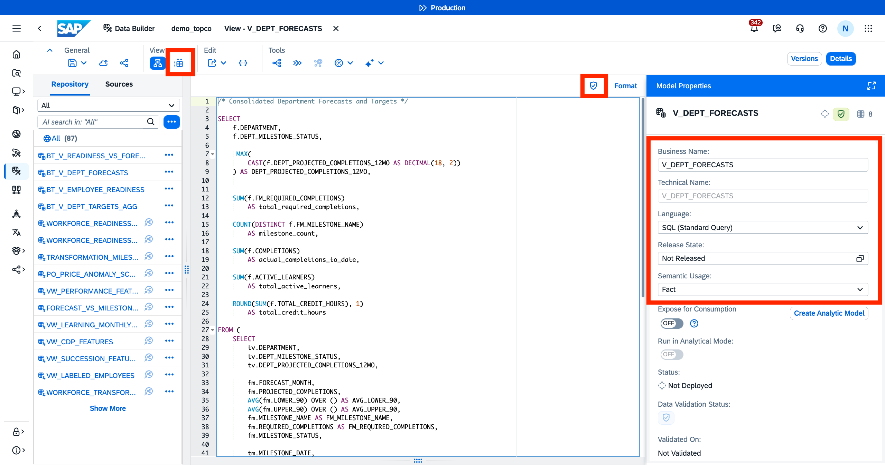

6. Save and deploy the view as `V_DEPT_FORECASTS`.
<br>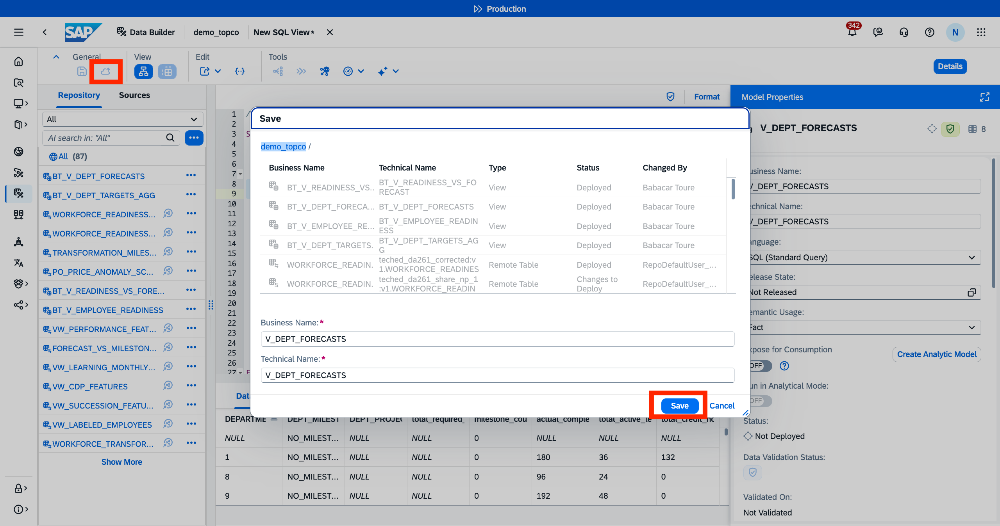

### Create a Fact View: Employee Forecasts
1. Open **Data Builder** in SAP Datasphere (TODO)
<br>

2. Search for the space and open it. Your space will have your username Eg. `ACXXXXXXXXX`
<br>

3. Create a new SQL view.
<br>

4. This SQL View designed to provide a 360-degree overview of employee readiness, learning activity, performance, skills development, and succession potential, combining individual employee data with workforce-level KPIs.

```
/* V_Employee_Readiness
Employee readiness, learning, performance, skills and succession KPIs
*/
SELECT
    -- Labeled Employees (hub table)
    le."EMPLOYEE_ID",
    le."READINESS_TIER_LABEL",
    le."LEARNING_VELOCITY_TREND",
    le."HIGH_POTENTIAL_FLAG",
    le."LEARNING_HOURS_LAST_6MO"         AS "LE_LEARNING_HOURS_LAST_6MO",
    le."ACTIVE_DEV_GOAL_COUNT"           AS "LE_ACTIVE_DEV_GOAL_COUNT",
    le."SKILL_PROFILE_UPDATES_6MO"       AS "LE_SKILL_PROFILE_UPDATES_6MO",

    -- Department (from Transformation Velocity)
    tv."DEPARTMENT",

    -- Learning Features
    lf."HOURS_RECENT_3MO",
    lf."HOURS_PRIOR_3MO",

    -- CDP Features
    cdp."CDP_MILESTONE_COMPLETION_RATE"   AS "CDP_COMPLETION_RATE",
    AVG(cdp."ACTIVE_DEV_GOAL_COUNT") OVER() AS "AVG_CDP_ACTIVE_GOALS",

    -- Performance Features
    AVG(pf."LATEST_PERF_RATING") OVER()  AS "PF_LATEST_PERF_RATING",
    AVG(pf."PERF_RATING_DELTA") OVER()   AS "PF_PERF_RATING_DELTA",
    pf."GOAL_COMPLETION_RATE"            AS "AVG_PF_GOAL_COMPLETION_RATE",

    -- Skills Signal
    ss."SKILL_PROFILE_UPDATES_6MO"       AS "SS_SKILL_PROFILE_UPDATES_6MO",

    -- Succession Features
    sf."CURRENT_READINESS_LEVEL",
    AVG(sf."READINESS_LEVEL_DELTA_12MO") OVER() AS "SF_READINESS_LEVEL_DELTA_12MO",
    sf."HIGH_POTENTIAL_FLAG"             AS "SF_HIGH_POTENTIAL_FLAG",

    -- Transformation Velocity
    tv."DEPT_MILESTONE_STATUS",
    tv."DEPT_PROJECTED_COMPLETIONS_12MO",

    -- Averages (Labeled Employees)
    AVG(le."DIGITAL_PROGRAM_COMPLETION_RATE") OVER() AS "AVG_LE_DIGITAL_PROGRAM_COMPLETION_RATE",
    AVG(le."CDP_MILESTONE_COMPLETION_RATE")   OVER() AS "AVG_LE_CDP_MILESTONE_COMPLETION_RATE",
    AVG(le."READINESS_LEVEL_DELTA_12MO")      OVER() AS "AVG_LE_READINESS_LEVEL_DELTA_12MO",
    AVG(le."LATEST_PERF_RATING")              OVER() AS "AVG_LE_LATEST_PERF_RATING",
    AVG(le."PERF_RATING_DELTA")               OVER() AS "AVG_LE_PERF_RATING_DELTA",
    AVG(le."GOAL_COMPLETION_RATE")            OVER() AS "AVG_LE_GOAL_COMPLETION_RATE",
    AVG(le."DAYS_SINCE_LAST_LEARNING")        OVER() AS "AVG_LE_DAYS_SINCE_LAST_LEARNING",

    -- Aggregated KPIs
    AVG(tv."READINESS_VELOCITY_INDEX") OVER()        AS "AVG_TV_VELOCITY_INDEX",
    SUM(tv."DEPT_PROJECTED_COMPLETIONS_12MO") OVER() AS "TOTAL_DEPT_PROJECTED_COMPLETIONS",
    SUM(lf."HOURS_RECENT_3MO") OVER()                AS "TOTAL_HOURS_RECENT_3MO",
    SUM(lf."HOURS_PRIOR_3MO") OVER()                 AS "TOTAL_HOURS_PRIOR_3MO",
    SUM(lf."HOURS_RECENT_3MO") OVER()
        / NULLIF(SUM(lf."HOURS_PRIOR_3MO") OVER(), 0) AS "LEARNING_MOMENTUM_RATIO",
    SUM(CAST(le."HIGH_POTENTIAL_FLAG" AS INTEGER)) OVER()
        / COUNT(*) OVER()                              AS "HIPO_DENSITY"

FROM "SNOWFLAKE8FBCB2C2.da261_share:v1.VW_LABELED_EMPLOYEES" le
LEFT JOIN "SNOWFLAKE8FBCB2C2.da261_share:v1.VW_LEARNING_FEATURES" lf
    ON le."EMPLOYEE_ID" = lf."EMPLOYEE_ID"
LEFT JOIN "SNOWFLAKE8FBCB2C2.da261_share:v1.VW_CDP_FEATURES" cdp
    ON le."EMPLOYEE_ID" = cdp."EMPLOYEE_ID"
LEFT JOIN "SNOWFLAKE8FBCB2C2.da261_share:v1.VW_PERFORMANCE_FEATURES" pf
    ON le."EMPLOYEE_ID" = pf."EMPLOYEE_ID"
LEFT JOIN "SNOWFLAKE8FBCB2C2.da261_share:v1.VW_SKILLS_SIGNAL" ss
    ON le."EMPLOYEE_ID" = ss."EMPLOYEE_ID"
LEFT JOIN "SNOWFLAKE8FBCB2C2.da261_share:v1.VW_SUCCESSION_FEATURES" sf
    ON le."EMPLOYEE_ID" = sf."EMPLOYEE_ID"
LEFT JOIN "SNOWFLAKE8FBCB2C2.da261_share:v1.WORKFORCE_TRANSFORMATION_VELOCITY" tv
    ON le."EMPLOYEE_ID" = tv."EMPLOYEE_ID"

```

5. Save and deploy the view as `V_EMPLOYEE_READINESS`.
<br>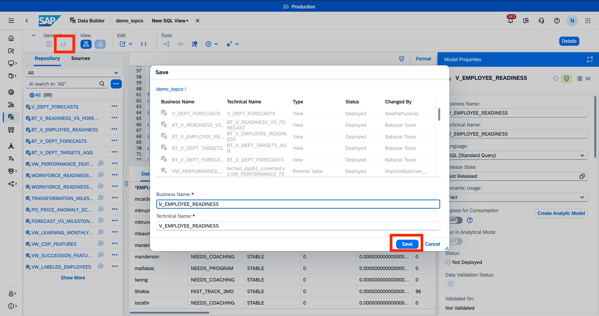

### Create a combined Fact view: DEPARTMENT VS. FORECAST
1. Open **Data Builder** in SAP Datasphere (TODO)
<br>

2. Search for the space and open it. Your space will have your username Eg. `ACXXXXXXXXX`
<br>

3. Create a new SQL view.
<br>

4. This view combines employee, learning, performance, skills, career-development, succession, and workforce-transformation data into one analytical view. It helps assess individual employee readiness while also providing workforce-wide KPIs.
```
/* V_READINESS_VS_FORECAST */
SELECT
    t."DEPARTMENT",
    t."DEPT_MILESTONE_STATUS",

    -- Forecast targets
    t."DEPT_PROJECTED_COMPLETIONS_12MO"                                                AS projected_completions_12mo,
    t."total_required_completions",
    t."milestone_count",
    t."actual_completions_to_date",
    t."total_active_learners",
    t."total_credit_hours",

    -- Employee readiness distribution
    COUNT(e."EMPLOYEE_ID")                                                             AS total_employees,
    SUM(CASE WHEN e."READINESS_TIER_LABEL" = 'READY_NOW'      THEN 1 ELSE 0 END)     AS ready_now,
    SUM(CASE WHEN e."READINESS_TIER_LABEL" = 'FAST_TRACK'     THEN 1 ELSE 0 END)     AS fast_track,
    SUM(CASE WHEN e."READINESS_TIER_LABEL" = 'NEEDS_COACHING' THEN 1 ELSE 0 END)     AS needs_coaching,
    SUM(CASE WHEN e."READINESS_TIER_LABEL" = 'NEEDS_PROGRAM'  THEN 1 ELSE 0 END)     AS needs_program,
    MAX(e."AVG_TV_VELOCITY_INDEX")                                               AS avg_velocity,
    SUM(CASE WHEN e."HIGH_POTENTIAL_FLAG" = 1 THEN 1 ELSE 0 END)                     AS high_potentials,

    -- Derived ratios
    ROUND(
        AVG(
            COUNT(CASE WHEN e."READINESS_TIER_LABEL" = 'READY_NOW' THEN 1 END) * 100.0
            / NULLIF(COUNT(e."EMPLOYEE_ID"), 0)
            ) OVER(), 1)                     AS avg_pct_ready_now,
    ROUND(
        COUNT(CASE WHEN e."READINESS_TIER_LABEL" IN ('READY_NOW', 'FAST_TRACK') THEN 1 END)
        * 100.0 / NULLIF(COUNT(e."EMPLOYEE_ID"), 0), 1)                               AS pct_on_track

FROM "V_DEPT_FORECASTS" t
LEFT JOIN "V_EMPLOYEE_READINESS" e
    ON t."DEPARTMENT" = e."DEPARTMENT"

GROUP BY
    t."DEPARTMENT",
    t."DEPT_MILESTONE_STATUS",
    t."DEPT_PROJECTED_COMPLETIONS_12MO",
    t."total_required_completions",
    t."milestone_count",
    t."actual_completions_to_date",
    t."total_active_learners",
    t."total_credit_hours"

ORDER BY t."DEPT_MILESTONE_STATUS", t."DEPARTMENT"

```
5. Validate the SQL and preview the results. Change configuration of the SQL view before saving.
<br>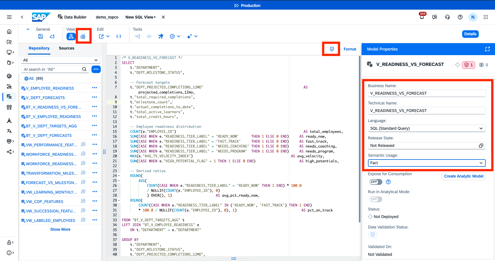

6. Save and deploy the view as `V_READINESS_VS_FORECAST`.
<br>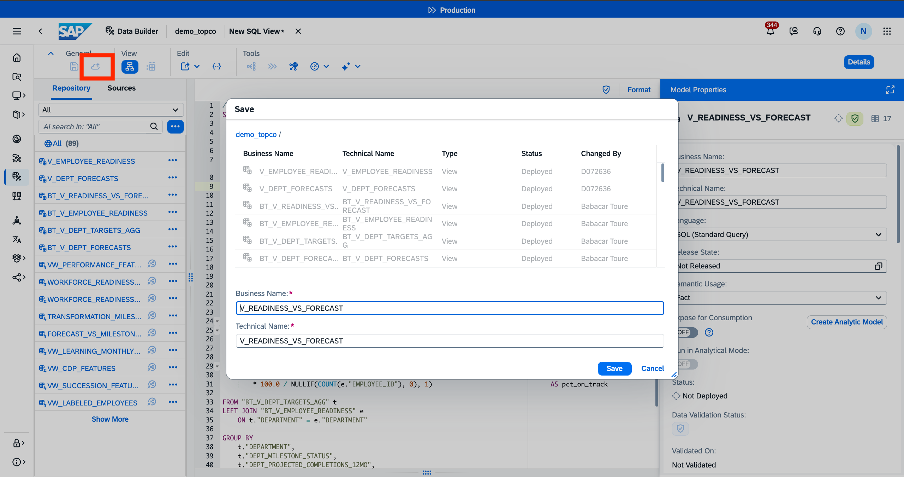

### Create Integrated Analytic Model
1. Open **Data Builder** in SAP Datasphere (TODO)
<br>

2. Search for the space and open it. Your space will have your username Eg. `ACXXXXXXXXX`
<br>

3. Create a new Analytic Model.
<br>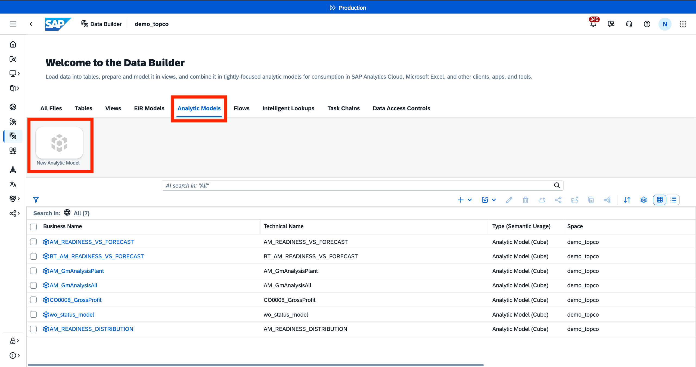

4. Drag and drop the Fact View `V_READINESS_VS_FORECAST` into the AM canvas.
<br>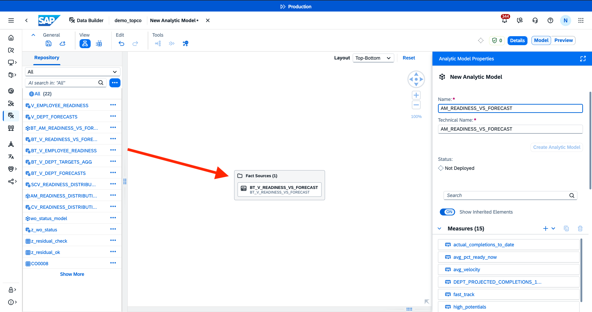

5. Inherit all the measures and dimensions from the Fact View into the Analytic Model
<br>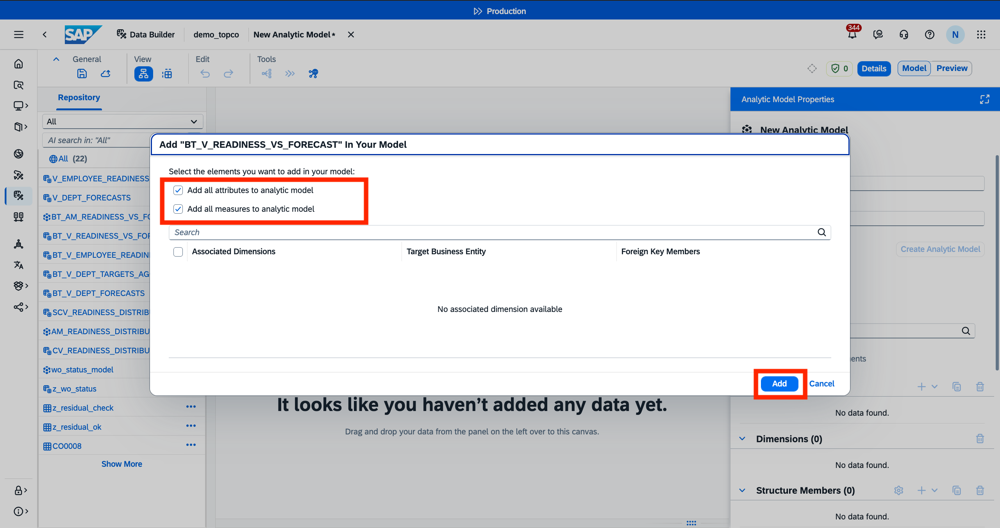

6. Save and Deploy the Analytic Model as `AM_READINESS_VS_FORECAST`.
<br>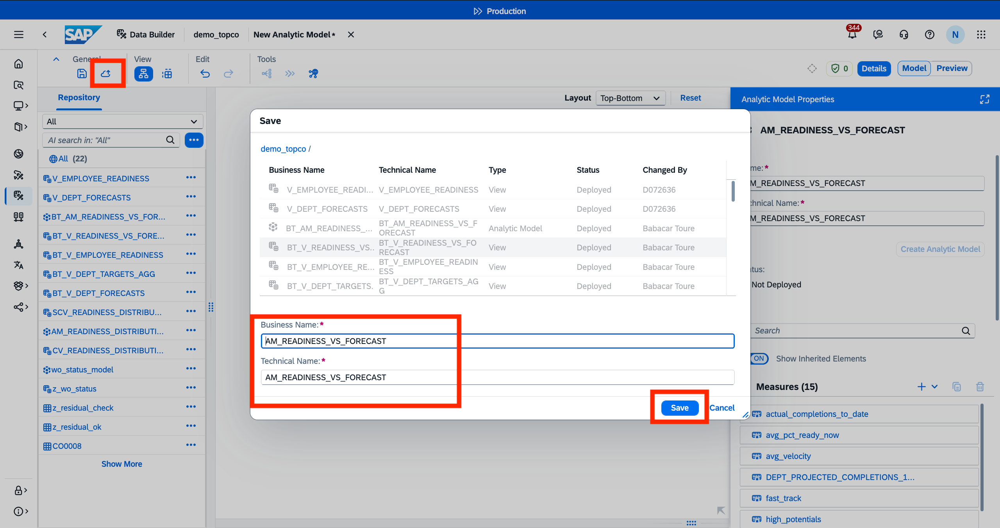

7. Preview the model to make sure that the data is queried correctly.

## Summary

You've now successfully created an integrated Analytic Model. 

Continue to - [Exercise 6 - Create an SAP Analytics Cloud Dashboard](../ex6/README.md)

