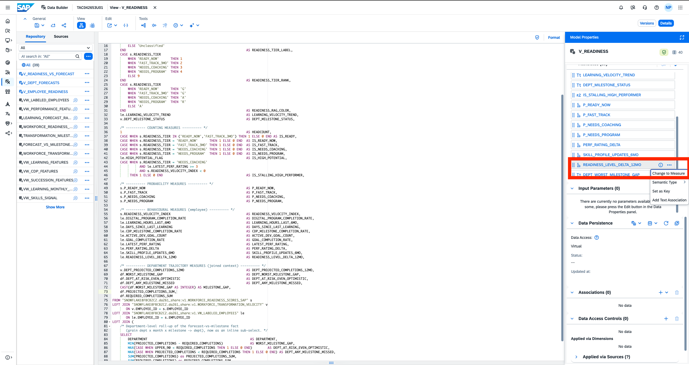

# Exercise 5 - HANDS-ON: Modelling in SAP Datasphere

In this exercise, we will create an integrated data model. We will use the data product published from SAP Snowflake and perform modelling in SAP Datasphere.

## Pre-requisites
- A custom space in [SAP Datasphere](https://trial-bdc-datasphere-3.eu10.hcs.cloud.sap/) provided to you named after your username
- Custom, Derived data product has been installed in the space in the previous exercise

## Exercise 
We will first create an integrated Fact view and then create an Analytic model on top of it.
In the Fact, we will create some aggregated KPIs to offer insights to a CHRO.

We have 12 tables to create an integrated view. For this use case, we will use the following tables:
- `WORKFORCE_READINESS_SCORES_SAP`
- `WORKFORCE_TRANSFORMATION_VELOCITY`
- `VW_LABELED_EMPLOYEES`
- `FORECAST_VS_MILESTONES_SAP`

There are other KPIs that can be derived from the other tables as well. But for our need, the four tables above are sufficient.

### Create a Fact View: Department Forecasts
1. Open **Data Builder** in [SAP Datasphere](https://trial-bdc-datasphere-3.eu10.hcs.cloud.sap/)
<br>

2. Search for the space and open it. Your space will have your username Eg. `TACXXXXXXXXX`
<br>

3. Create a new SQL view with the code below. The share name can be replaced with your own share name if you replace your own data product for the fact view.
<br>


```

SELECT
    /* ---------- KEY ---------- */
    s.EMPLOYEE_ID                                                     AS EMPLOYEE_ID,

    /* ---------- DIMENSIONS / ATTRIBUTES ---------- */
    s.DEPARTMENT                                                      AS DEPARTMENT,
    TO_NVARCHAR(s.DEPARTMENT)                                         AS DEPARTMENT_CODE,
    s.JOB_TITLE                                                       AS JOB_TITLE,
    s.READINESS_TIER                                                  AS READINESS_TIER,
    CASE s.READINESS_TIER
        WHEN 'READY_NOW'      THEN 'Ready Now'
        WHEN 'FAST_TRACK_3MO' THEN 'Fast Track (3 months)'
        WHEN 'NEEDS_COACHING' THEN 'Needs Coaching'
        WHEN 'NEEDS_PROGRAM'  THEN 'Needs Structured Program'
        ELSE 'Unclassified'
    END                                                              AS READINESS_TIER_LABEL,
    CASE s.READINESS_TIER
        WHEN 'READY_NOW'      THEN 1
        WHEN 'FAST_TRACK_3MO' THEN 2
        WHEN 'NEEDS_COACHING' THEN 3
        WHEN 'NEEDS_PROGRAM'  THEN 4
        ELSE 9
    END                                                              AS READINESS_TIER_RANK,
    CASE s.READINESS_TIER
        WHEN 'READY_NOW'      THEN 'G'
        WHEN 'FAST_TRACK_3MO' THEN 'G'
        WHEN 'NEEDS_COACHING' THEN 'A'
        WHEN 'NEEDS_PROGRAM'  THEN 'R'
        ELSE 'A'
    END                                                              AS READINESS_RAG_COLOR,
    le.LEARNING_VELOCITY_TREND                                       AS LEARNING_VELOCITY_TREND,
    v.DEPT_MILESTONE_STATUS                                          AS DEPT_MILESTONE_STATUS,

    /* ---------- COUNTING MEASURES ---------- */
    1                                                                AS HEADCOUNT,
    CASE WHEN s.READINESS_TIER IN ('READY_NOW','FAST_TRACK_3MO') THEN 1 ELSE 0 END AS IS_READY,
    CASE WHEN s.READINESS_TIER = 'READY_NOW'      THEN 1 ELSE 0 END  AS IS_READY_NOW,
    CASE WHEN s.READINESS_TIER = 'FAST_TRACK_3MO' THEN 1 ELSE 0 END  AS IS_FAST_TRACK,
    CASE WHEN s.READINESS_TIER = 'NEEDS_COACHING' THEN 1 ELSE 0 END  AS IS_NEEDS_COACHING,
    CASE WHEN s.READINESS_TIER = 'NEEDS_PROGRAM'  THEN 1 ELSE 0 END  AS IS_NEEDS_PROGRAM,
    le.HIGH_POTENTIAL_FLAG                                           AS IS_HIGH_POTENTIAL,
    CASE WHEN s.READINESS_TIER = 'NEEDS_COACHING'
              AND le.LATEST_PERF_RATING >= 3
              AND s.READINESS_VELOCITY_INDEX < 0
         THEN 1 ELSE 0 END                                           AS IS_STALLING_HIGH_PERFORMER,

    /* ---------- PROBABILITY MEASURES ---------- */
    s.P_READY_NOW                                                    AS P_READY_NOW,
    s.P_FAST_TRACK                                                   AS P_FAST_TRACK,
    s.P_NEEDS_COACHING                                               AS P_NEEDS_COACHING,
    s.P_NEEDS_PROGRAM                                                AS P_NEEDS_PROGRAM,

    /* ---------- BEHAVIOURAL MEASURES (employee) ---------- */
    s.READINESS_VELOCITY_INDEX                                       AS READINESS_VELOCITY_INDEX,
    le.DIGITAL_PROGRAM_COMPLETION_RATE                               AS DIGITAL_PROGRAM_COMPLETION_RATE,
    le.LEARNING_HOURS_LAST_6MO                                       AS LEARNING_HOURS_LAST_6MO,
    le.DAYS_SINCE_LAST_LEARNING                                      AS DAYS_SINCE_LAST_LEARNING,
    le.CDP_MILESTONE_COMPLETION_RATE                                 AS CDP_MILESTONE_COMPLETION_RATE,
    le.ACTIVE_DEV_GOAL_COUNT                                         AS ACTIVE_DEV_GOAL_COUNT,
    le.GOAL_COMPLETION_RATE                                          AS GOAL_COMPLETION_RATE,
    le.LATEST_PERF_RATING                                            AS LATEST_PERF_RATING,
    le.PERF_RATING_DELTA                                             AS PERF_RATING_DELTA,
    le.SKILL_PROFILE_UPDATES_6MO                                     AS SKILL_PROFILE_UPDATES_6MO,
    le.READINESS_LEVEL_DELTA_12MO                                    AS READINESS_LEVEL_DELTA_12MO,

    /* ---------- DEPARTMENT TRAJECTORY MEASURES (joined context) ---------- */
    v.DEPT_PROJECTED_COMPLETIONS_12MO                                AS DEPT_PROJECTED_COMPLETIONS_12MO,
    df.WORST_MILESTONE_GAP                                           AS DEPT_WORST_MILESTONE_GAP,
    df.DEPT_AT_RISK_EVEN_OPTIMISTIC                                  AS DEPT_AT_RISK_EVEN_OPTIMISTIC,
    df.DEPT_ANY_MILESTONE_MISSED                                     AS DEPT_ANY_MILESTONE_MISSED,
    CAST(df.WORST_MILESTONE_GAP AS INTEGER) AS MILESTONE_GAP,
    df.PROJECTED_COMPLETIONS_SUM,
    df.REQUIRED_COMPLETIONS_SUM
FROM "SNOWFLAKE8FBCB2C2.da261_share:v1.WORKFORCE_READINESS_SCORES_SAP" s
LEFT JOIN "SNOWFLAKE8FBCB2C2.da261_share:v1.WORKFORCE_TRANSFORMATION_VELOCITY" v
       ON v.EMPLOYEE_ID = s.EMPLOYEE_ID
LEFT JOIN "SNOWFLAKE8FBCB2C2.da261_share:v1.VW_LABELED_EMPLOYEES" le
       ON le.EMPLOYEE_ID = s.EMPLOYEE_ID
LEFT JOIN (
    /* Department-level roll-up of the forecast-vs-milestone fact
       (grain dept x month x milestone -> dept), now as an inline sub-select. */
    SELECT
        DEPARTMENT                                                     AS DEPARTMENT,
        MIN(PROJECTED_COMPLETIONS - REQUIRED_COMPLETIONS)              AS WORST_MILESTONE_GAP,
        MAX(CASE WHEN UPPER_90 < REQUIRED_COMPLETIONS THEN 1 ELSE 0 END)        AS DEPT_AT_RISK_EVEN_OPTIMISTIC,
        MAX(CASE WHEN PROJECTED_COMPLETIONS < REQUIRED_COMPLETIONS THEN 1 ELSE 0 END) AS DEPT_ANY_MILESTONE_MISSED,
        SUM(PROJECTED_COMPLETIONS) as PROJECTED_COMPLETIONS_SUM,
        SUM(REQUIRED_COMPLETIONS) as REQUIRED_COMPLETIONS_SUM
    FROM "SNOWFLAKE8FBCB2C2.da261_share:v1.FORECAST_VS_MILESTONES_SAP"
    GROUP BY DEPARTMENT
) df
       ON df.DEPARTMENT = s.DEPARTMENT;

```

4. Validate the SQL and preview the results. Change configuration of the view. It is important to validate SQL and set the semantic usage to `Fact` before the next step.
<br>

5. Convert the following attributes into measures with the appropriate aggregation (22 Measures in total): <br/>
<br><br/>

<table>
  <tr>
    <th>Attribute Name</th>
    <th>Agregation</th>
  </tr>
  <tr>
    <td>HEADCOUNT</td>
    <td>SUM</td>
  </tr>
  <tr>
    <td>IS_READY</td>
    <td>SUM</td>
  </tr>
   <tr>
    <td>IS_READY_NOW</td>
    <td>SUM</td>
  </tr>
   <tr>
    <td>IS_FAST_TRACK</td>
    <td>SUM</td>
  </tr>
   <tr>
    <td>IS_NEEDS_COACHING</td>
    <td>SUM</td>
  </tr>
   <tr>
    <td>IS_NEEDS_PROGRAM</td>
    <td>SUM</td>
  </tr>
     <tr>
    <td>IS_HIGH_POTENTIAL</td>
    <td>SUM</td>
  </tr>
       <tr>
    <td>READINESS_VELOCITY_INDEX</td>
    <td>SUM</td>
  </tr>
    <tr>
    <td>DIGITAL_PROGRAM_COMPLETION_RATE</td>
    <td>SUM</td>
  </tr>
    <tr>
    <td>LEARNING_HOURS_LAST_6MO</td>
    <td>SUM</td>
  </tr>
    <tr>
    <td>DAYS_SINCE_LAST_LEARNING</td>
    <td>SUM</td>
  </tr>
   <tr>
    <td>CDP_MILESTONE_COMPLETION_RATE</td>
    <td>SUM</td>
  </tr>
  <tr>
    <td>ACTIVE_DEV_GOAL_TIME</td>
    <td>SUM</td>
  </tr>
  <tr>
    <td>GOAL_COMPLETION_RATE</td>
    <td>SUM</td>
  </tr>
    <tr>
    <td>LATEST_PERF_RATING</td>
    <td>SUM</td>
  </tr>
    <tr>
    <td>DEPT_PROJECTED_COMPLETIONS_12MO</td>
    <td>SUM</td>
  </tr>
   <tr>
    <td>DEPT_AT_RISK_EVEN_OPTIMISTIC</td>
    <td>SUM</td>
  </tr>
    <tr>
    <td>DEPT_ANY_MILESTONE_MISSED</td>
    <td>SUM</td>
  </tr>
   <tr>
    <td>MILESTONE_GAP</td>
    <td>MAX</td>
  </tr>
   <tr>
    <td>PROJECTED_COMPLETIONS_SUM</td>
    <td>MAX</td>
  </tr>
   <tr>
    <td>REQUIRED_COMPLETIONS_SUM</td>
    <td>MAX</td>
  </tr>
</table>

<br/>


6. Save and deploy the view as `V_READINESS_VS_FORECAST`.
<br>


### Create Integrated Analytic Model
1. Open **Data Builder** in [SAP Datasphere](https://trial-bdc-datasphere-3.eu10.hcs.cloud.sap/)
<br>

2. Search for the space and open it. Your space will have your username Eg. `ACXXXXXXXXX`
<br>

3. Create a new Analytic Model.
<br>

4. Drag and drop the Fact View `V_READINESS_VS_FORECAST` into the AM canvas.
<br>

5. Inherit all the measures and dimensions from the Fact View into the Analytic Model
<br>

6. Save and Deploy the Analytic Model as `AM_READINESS_VS_FORECAST`.
<br>

7. Preview the model to make sure that the data is queried correctly.

## Summary

You've now successfully created an integrated Analytic Model. 

Continue to - [Exercise 6 - Create an SAP Analytics Cloud Dashboard](../ex6/README.md)

