# Creating a Story in SAP Analytics Cloud — Employee Readiness vs Forecast

## Overview

In this exercise, we will build the **Employee Readiness vs Forecast** dashboard in SAP Analytics Cloud. The story tracks workforce readiness levels, learning completion progress, and active learner coverage across departments and milestone statuses.

A Story in SAP Analytics Cloud is a reporting and visualization tool that allows users to analyse data through charts, tables, filters, and interactive dashboards. Stories can be created using imported or live data models and can be shared across the organization. The end result of this exercise will be as below.

<br/>


## Prerequisites

Before creating a story, ensure that:

- You have access to SAP Analytics Cloud.
- A data model is available and accessible (e.g. from SAP SuccessFactors Learning or a custom HR model in SAP Datasphere).
- You have the required permissions to create and save stories.
- The data source contains the following dimensions and measures:

| Type | Name | Description |
|---|---|---|
| Dimension | `Department` | Organizational unit |
| Dimension | `Milestone_Status` | `NO_MILESTONE` · `ON_TRACK` · `WILL_MISS` |
| Dimension | `Readiness_Tier` | `ready_now` · `needs_coaching` · `needs_program` · `fast_track` |
| Measure | `Headcount` | Total number of employees |
| Measure | `Ready_Now_Count` | Employees in the `ready_now` tier |
| Measure | `On_Track_Count` | Employees on track (including fast-track) |
| Measure | `Actual_Completions` | Learning completions recorded to date |
| Measure | `Required_Completions` | Target completions required |
| Measure | `Active_Learners` | Number of currently active learners |
| Measure | `Learner_Target` | Coverage target for active learners |
| Measure | `High_Potential_Count` | Employees flagged as high potential |
| Measure | `Credit_Hours` | Total credit hours accumulated |
| Measure | `Milestone_Count` | Number of milestones per department |


## Create Story and Import Model

### Step 1: Create a Canvas Story

<br/>

1. From the SAC home screen, select **Stories**.
2. Click **+ Create New Story**.
3. Click on **Canvas**.


### Step 2: Select a Model or Dataset

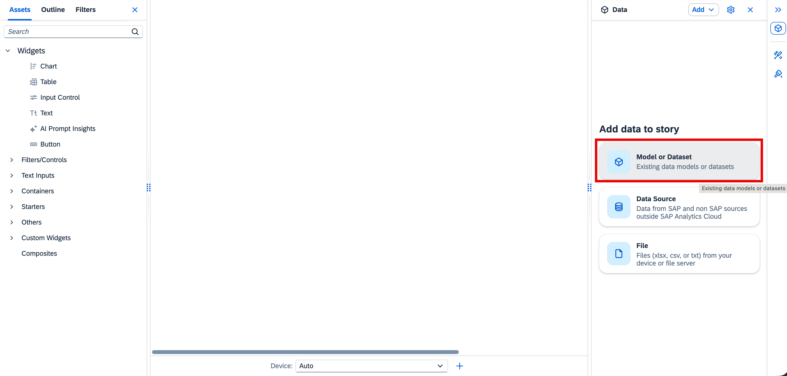<br/>
### Search for your Model or Dataset in the SAPDWC folder and select it
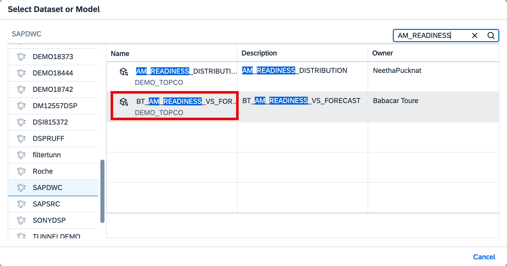<br/>

Once the data is now connected to the story, Drag & drop **Chart** under **Widget** into the canvas.

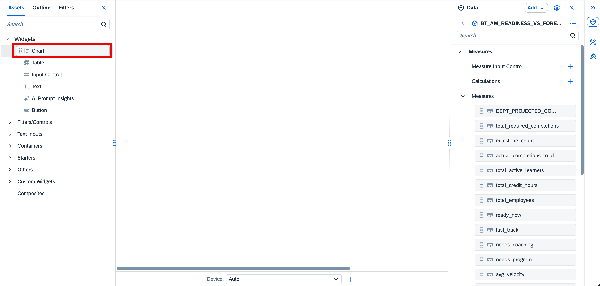<br/>
In the next sections, we will create the KPI tiles and charts that make up the Executive Summary page.


---

## Section 1: KPI Tiles — Executive Summary

The top row of the dashboard contains **five Numeric Point (KPI) widgets** that display the most critical readiness metrics at a glance.

<br/>

### Step 1: Insert a Numeric Point Widget

1. Make sure you are on the Builder tab.
2. Select **Numeric Point** (also labelled *KPI Tile* in some SAC versions).
3. Resize it to occupy roughly one-fifth of the page width.

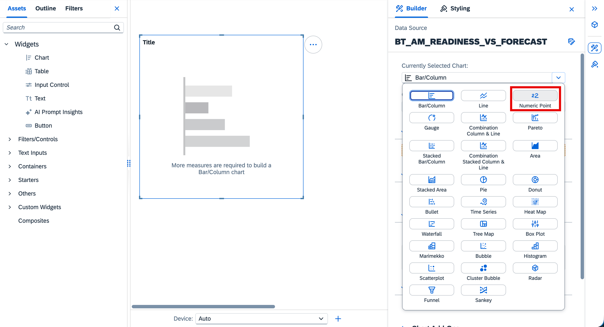<br/>
> **Note:**
> Repeat this insert step for each of the five KPI tiles below. Place them side by side in a single row across the full page width.

---

### Step 2: Configure — Overall Readiness Rate

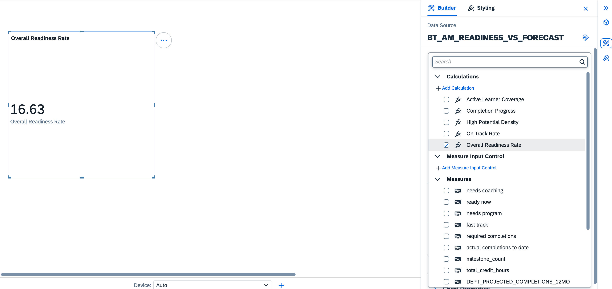<br/>

1. Select the KPI widget and open the **Builder** panel on the right.
2. Under **Primary Value**, click **+ Add Measure** → **Add Calculation**.
3. Name the measure `READINESS_RATE`.
4. In the **Edit Formula** area, enter:
   ```
   [Ready_Now_Count] / [Headcount] * 100
   ```
5. Click **OK**.
6. Set the **Number Format** to `Percentage` with **2 decimal places**.
7. Under **Title**, type: `Overall Readiness Rate`
8. Under **Subtitle**, type: `% of workforce is ready now`
9. Set a **Color Threshold**:
   - ≥ 20% → Green
   - 10–20% → Amber
   - < 10% → Red

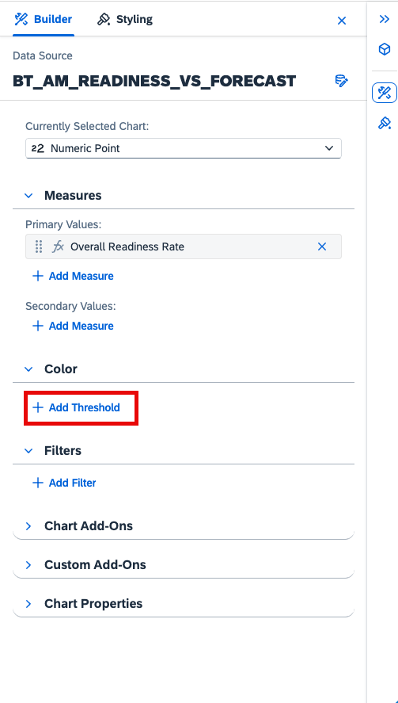<br/>
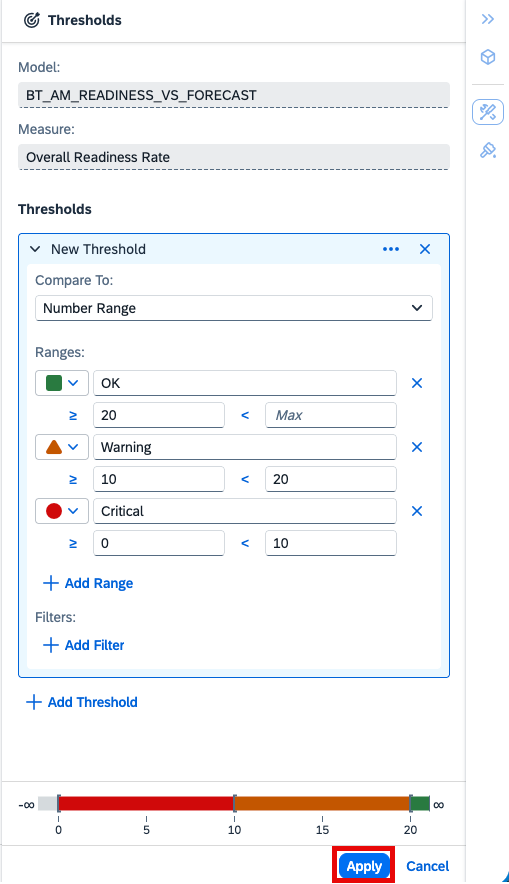<br/>


---

### Step 3: Configure — On-Track Rate

1. Select the second KPI widget and open the **Builder** panel.
2. Under **Primary Value**, click **+ Add Measure** → **Add Calculation**.
3. Name the measure `ON_TRACK_RATE`.
4. In the **Edit Formula** area, enter:
   ```
   [On_Track_Count] / [Headcount] * 100
   ```
5. Click **OK**.
6. Set the **Number Format** to `Percentage` with **2 decimal places**.
7. Under **Title**, type: `On-Track Rate`
8. Under **Subtitle**, type: `Broader pipeline including fast-track`
9. Set a **Color Threshold**:
   - ≥ 20% → Green
   - 10–20% → Amber
   - < 10% → Red

---

### Step 4: Configure — Completion Progress

1. Select the third KPI widget and open the **Builder** panel.
2. Under **Primary Value**, click **+ Add Measure** → **Add Calculation**.
3. Name the measure `COMPLETION_PROGRESS`.
4. In the **Edit Formula** area, enter:
   ```
   [Actual_Completions] / [Required_Completions] * 100
   ```
5. Click **OK**.
6. Set the **Number Format** to `Percentage` with **2 decimal places**.
7. Under **Title**, type: `Completion Progress`
8. Under **Subtitle**, type: `% of required learning completed org-wide`
9. Set a **Color Threshold**:
   - ≥ 20% → Green
   - 10–20% → Amber
   - < 10% → Red

---

### Step 5: Configure — High Potential Density

1. Select the fourth KPI widget and open the **Builder** panel.
2. Under **Primary Value**, click **+ Add Measure** → **Add Calculation**.
3. Name the measure `HIGH_POT_DENSITY`.
4. In the **Edit Formula** area, enter:
   ```
   [High_Potential_Count] / [Headcount] * 100
   ```
5. Click **OK**.
6. Set the **Number Format** to `Percentage` with **2 decimal places**.
7. Under **Title**, type: `High Potential Density`
8. Under **Subtitle**, type: `Share of high potentials in workforce`


---

### Step 6: Configure — Active Learner Coverage (KPI)

1. Select the fifth KPI widget and open the **Builder** panel.
2. Under **Primary Value**, click **+ Add Measure** and select `Active_Learners` directly (no formula needed).
3. Set the **Number Format** to `Number` with **2 decimal places**.
4. Under **Title**, type: `Active Learner Coverage`
5. Under **Subtitle**, type: `Active learners vs. target`
   > Expected value: **32,737.16**

### Step 7: Save the Story

1. Click **Save** (top-right).
2. Enter:
   - **Story Name**: e.g. `EmployeeReadiness_ACXXXXXXX`
   - **Description**: `Employee Readiness vs Forecast — Executive Summary`
   - **Folder Location**: Select your team folder
3. Click **Save**.


---

## Chart 1: Department Milestone Status

This chart shows the distribution of **milestone status across departments**, split into `NO_MILESTONE`, `ON_TRACK`, and `WILL_MISS` categories, making it easy to spot which departments are at risk.

<br/>

### Step 1: Add a Chart

1. Click **Insert** from the top ribbon.
2. Select **Chart**. Drag it onto the canvas below the KPI row on the **left side** (approx. 60% width).

### Step 2: Open the Builder Configuration

- The **Builder** panel opens on the right side.
- Select the chart type — **Donut** is used for this chart.

### Step 3: Assign Measures and Dimensions

> [!Note]
> See the image after step 4 for reference. This image shows the target state of the Builder configuration that we want to achieve.

**Measure** — `needs_coaching`:
1. Under **Measures**, click **+ Add Measure**.
2. Select `needs_coaching` from the model.
3. Click **OK** — the measure is added to the chart.

### Step 4: Assign Color

1. Under **Color**, click **+ Add Dimension/Threshold**.
2. Select `Milestone_Status` — this splits each department bar into colored segments.
   > The three members are: `NO_MILESTONE` (Red) · `ON_TRACK` (Green) · `WILL_MISS` (Amber)

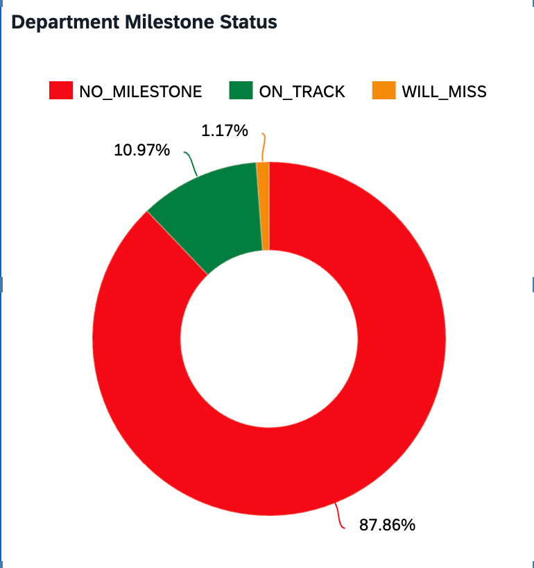<br/>


### Step 5: Save Changes

Click **Save** to save changes.


---

## Chart 2: Readiness Tier Split

This chart shows the **org-wide distribution of employees** across the four readiness tiers, giving a quick view of how ready the workforce is as a whole.

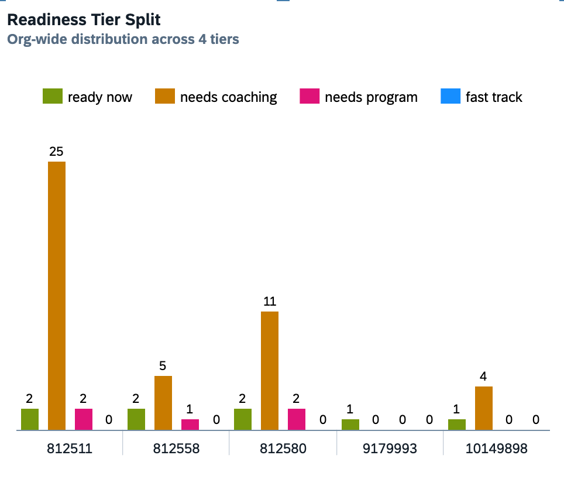<br/>

### Step 1: Insert a New Chart

1. Click **Insert** from the top ribbon.
2. Select **Chart**. Drag it onto the canvas to the **right of the Donut Chart** (approx. 40% width).

### Step 2: Open the Builder Configuration


- The **Builder** panel opens on the right side for the new chart.
- Select the chart type — **Bar/Column** is used for this chart.

### Step 3: Assign Measures and Dimensions

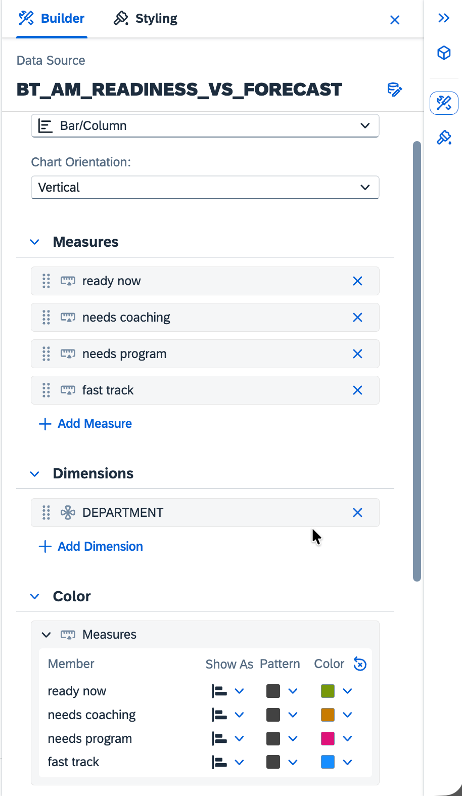<br/>

**Measure** — `Headcount`:
1. Under **Measures**, click **+ Add Measure**.
2. Select  - `ready_now` 
   - `needs_coaching`
   - `needs_program`
   - `fast_track`
3. Click **OK** — SAC will compute the percentage contribution per slice automatically.

**Dimension** — `Department`:
1. Under **Dimensions**, click **+ Add Dimension**.
2. Select `Department`.
3. This splits the donut into four slices.

### Step 4: Assign Color

1. Under **Color**, click **+ Add Dimension/Threshold**.
2. Assign individual colors to each tier member:
   - `ready_now` → Green
   - `needs_coaching` → Amber
   - `needs_program` → Blue
   - `fast_track` → Purple


### Step 5: Save Changes

Click **Save** to save changes.


---

## Chart 3: Actual vs Projected Completions

This chart compares **actual learning completions to date** against the **required completion targets**, allowing managers to assess whether the workforce is on pace.

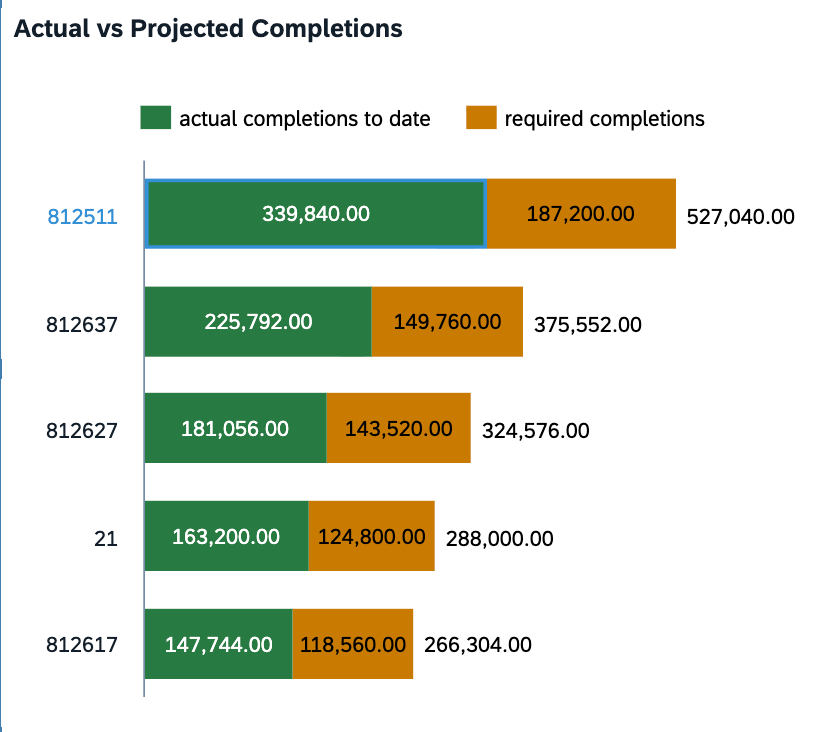<br/>

### Step 1: Insert a New Chart

1. Click **Insert** from the top ribbon.
2. Select **Chart**. Place it below Charts 1 and 2, on the **left third** of the row.

### Step 2: Open the Builder Configuration


- The **Builder** panel opens on the right side.
- Select the chart type — **Stacked Bar/Column** is used for this chart.

### Step 3: Assign Measures

Under **Measures**, click **+ Add Measure** and add both measures:

1. Select `Actual_Completions_to_date` — this represents completions recorded to date.
2. Select `Required_Completions` — this is the projected target.

### Step 4: Assign Dimensions

1. Under **Dimensions**, click **+ Add Dimension**.
2. Select `Department`.

### Step 5: Add a Reference Line

Adding a reference line highlights the completion target clearly on the chart.

1. In the Builder, scroll to **Chart Add-Ons**.
2. Click **+ Add Reference Line**.
3. Set the axis to **Y-Axis (Value)**.
4. Set the value to the `Required_Completions` measure (dynamic reference).
5. Set the line style to **Dashed** and color to **Orange**.
6. Label it: `Target`

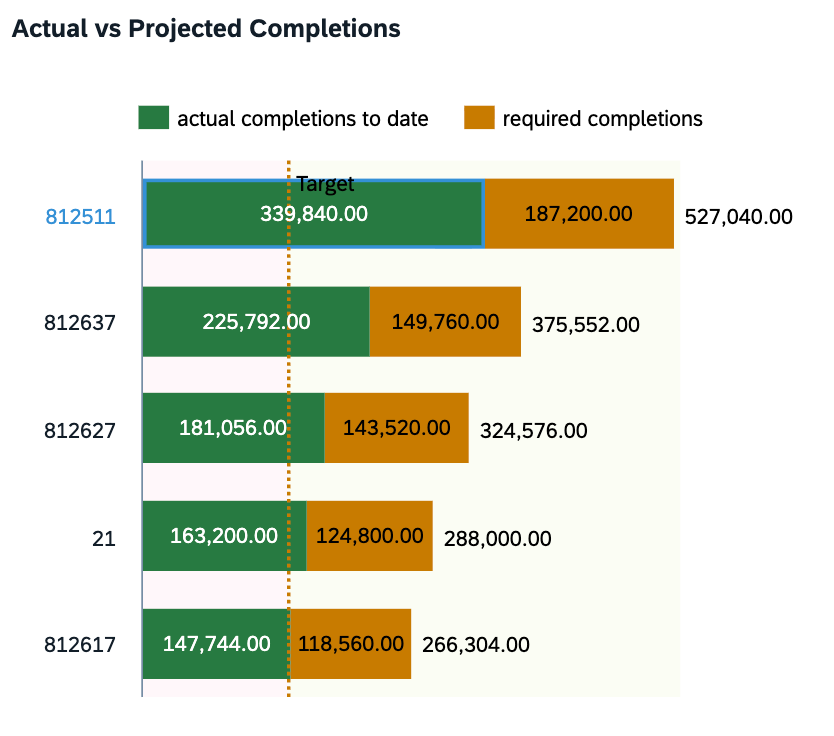<br/>


### Step 6: Save Changes

Click **Save** to save changes.


---

## Add Page-Level Filters

To make the dashboard interactive, add **Input Controls** so viewers can filter all charts simultaneously.

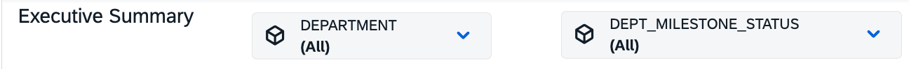<br/>

1. Click **Insert** → **Input Control**.
2. Select filter type **Dropdown** and bind it to the `Department` dimension. Label it `Department`.
3. Repeat for `Milestone_Status` — use a **Multi-Select Dropdown**.
4. Place all the Input Controls in the page header area, above the KPI tiles.

> [!Note]
> Input Controls affect all charts on the page when **Linked Analysis** is enabled. To verify, select a chart, open the **Builder**, scroll to **Linked Analysis**, and confirm **All Widgets on Page** is checked.


