# Creating a Story in SAP Analytics Cloud

## Overview

In this exercise, we will build the **Employee Readiness vs Forecast** dashboard in SAP Analytics Cloud. The story tracks workforce readiness levels and learning completion progress across departments and milestone statuses.

A Story in SAP Analytics Cloud is a reporting and visualization tool that allows users to analyse data through charts, tables, filters, and interactive dashboards. Stories can be created using imported or live data models and can be shared across the organization. The end result of this exercise will be as below.

 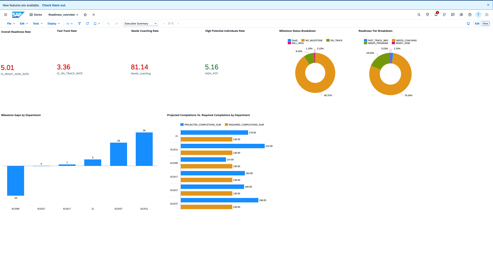

## Prerequisites

Before creating a story, ensure that:

- You have access to [SAP Analytics Cloud](https://trial-bdc-sac-3.eu10.sapanalytics.cloud/).
- A data model is available and accessible (built in the previous exercise)
- You have the required permissions to create and save stories.

## Create Story and Import Model

### Step 1: Create a Canvas Story
1. From the SAC home screen, select **Stories**.
2. Click on **Canvas**.

 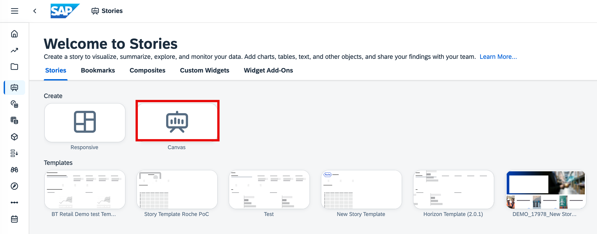

### Step 2: Change Page Title
1. Change the Page title by double clicking the tile as shown below.Rename the page title as `Executive Summary` 

 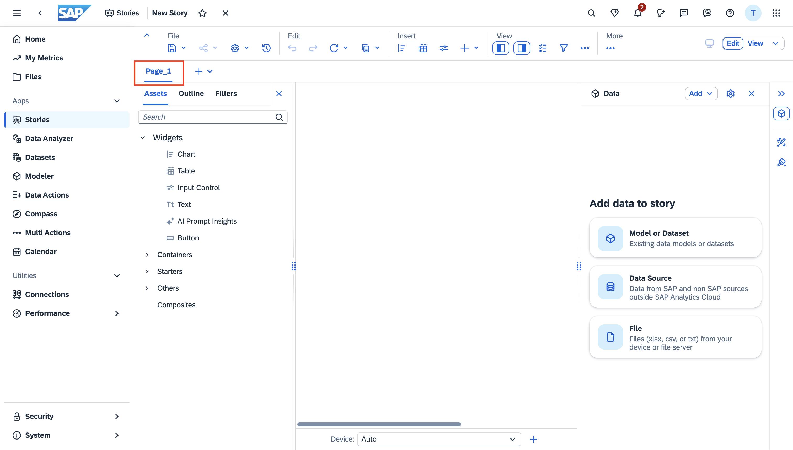

### Step 3: Select a Model or Dataset
1. Search for your Model which you built in the previous exercise. `SAPSRC` is the Datasphere connection. Search for your space name which is same as your username and select the model that you built in the previous exercise.  

 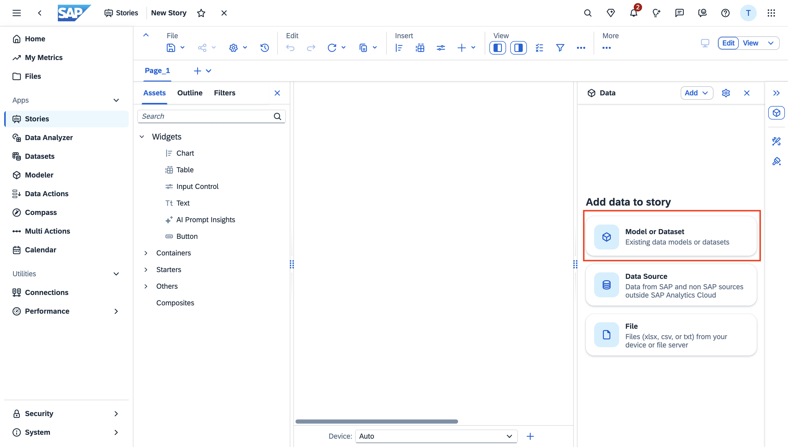
 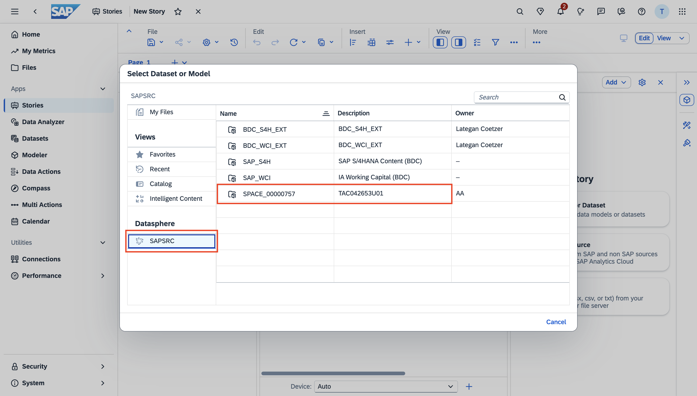

3. In the next sections, we will create the KPI tiles and charts that make up the Executive Summary page. 

---

## Create KPI Tiles — Executive Summary

The top row of the dashboard contains **four Numeric Point (KPI) widgets** that display the most critical readiness metrics at a glance.

 

### Insert a Numeric Point Widget

1. Make sure you are on the Builder tab. Drag and drop the chart widget.
2. Set the chart type to **Numeric Point**.
3. Resize it to occupy roughly one-sixth of the page width.

 

4. For each of the next four Numeric Point charts, you will do the following:
- Open the Builder & add a new measure

 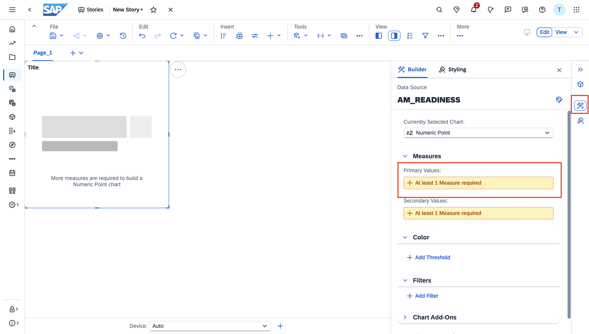

- Add a new Calculation

 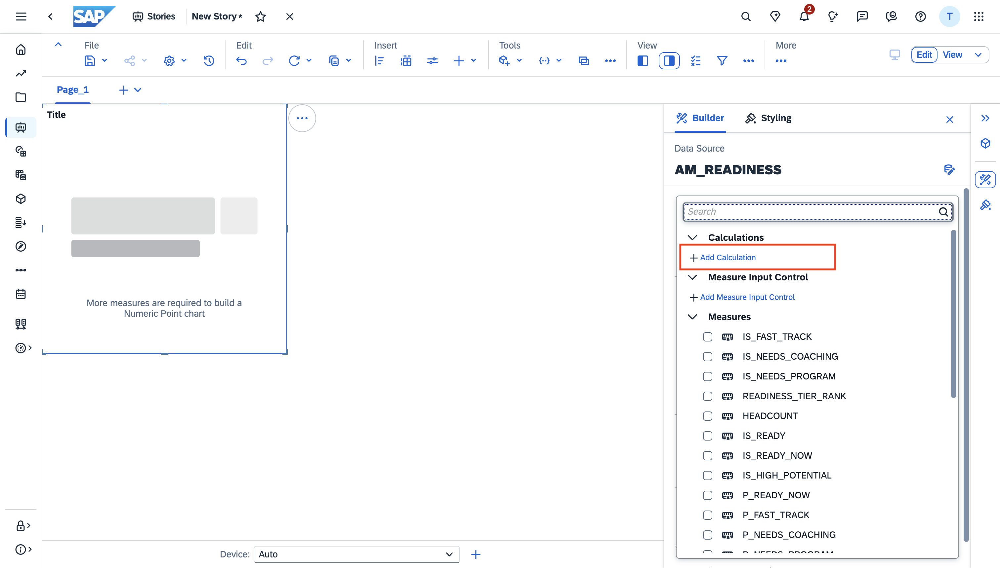

- In the calculation dialog, select `Calculated Measure`. Set a meaningful name for the measure. Add the calculation formula. Click `OK`.

 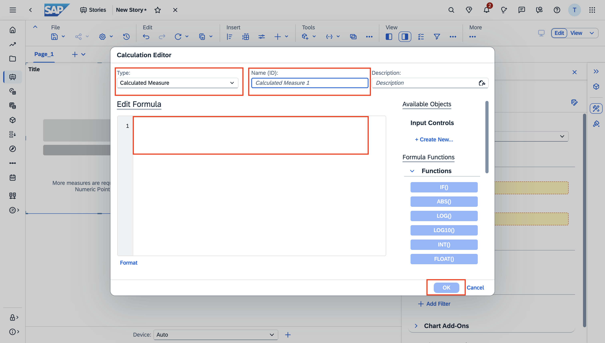

- Add a Colour Threshold as follows: Add Colour and Threshold

 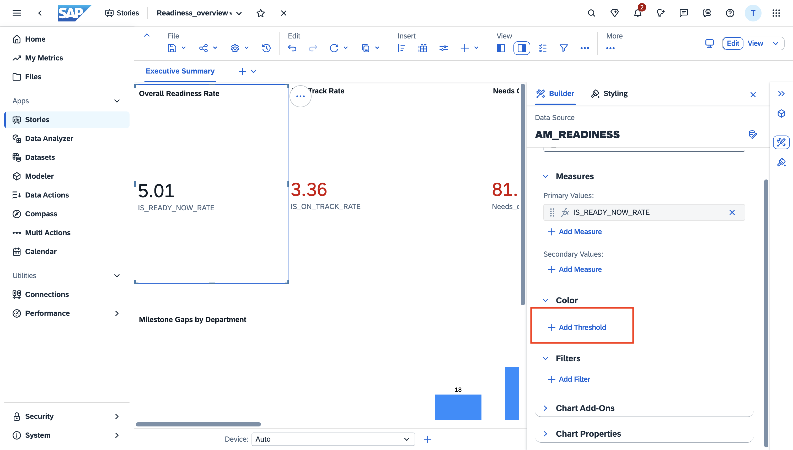

 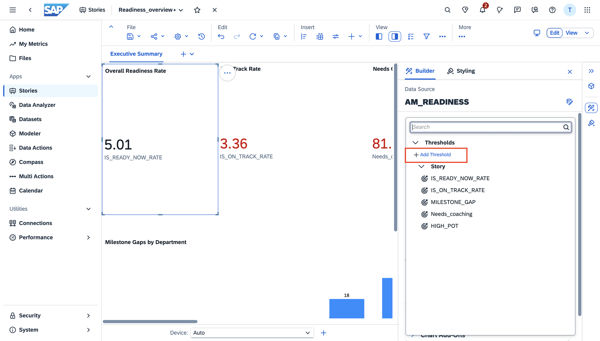

- Add the KPI name and set the range for each of the KPIs and `Apply`.

 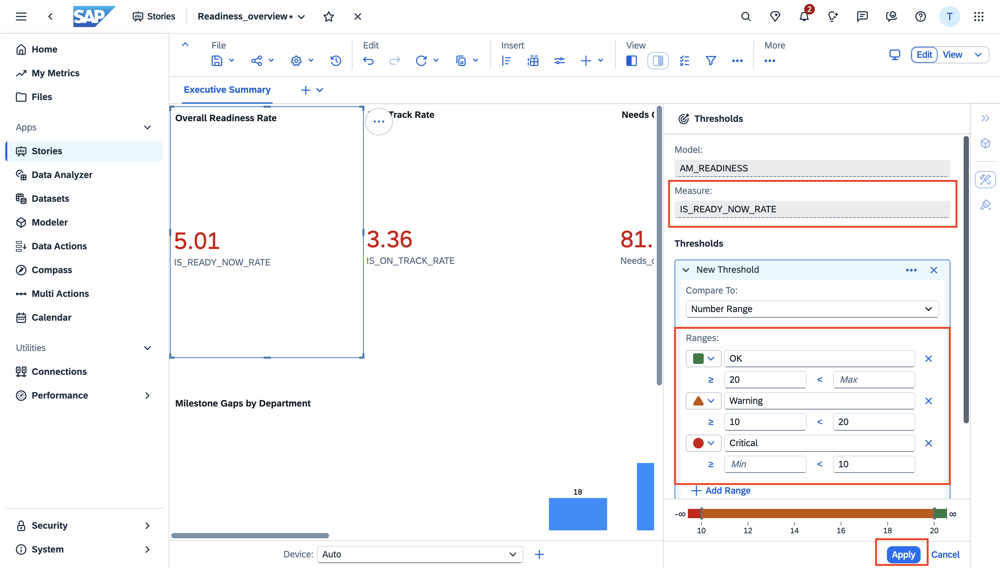

- Add the Colour Threshold for each of the KPIs.

 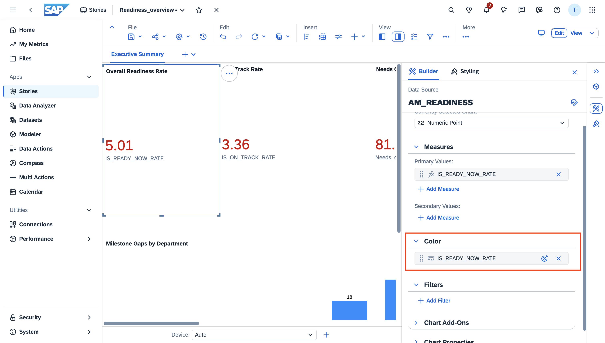

> **Note:**
> You will repeat this insert step for each of the five KPI tiles below. Place them side by side in a single row across the full page width. Let us see in the next steps how to create each of the KPI tiles. Follow the above instructions for each of the tiles with the details and formulae mentioned for each below.

---

### Chart 1: Overall Readiness Rate
Create a Numeric Point chart widget with the steps mentioned above.
- Name (ID): `IS_READY_NOW_RATE`

- Formula: ["AM_READINESS":IS_READY]/["AM_READINESS":HEADCOUNT]*100

- Title: Overall Readiness Rate

Color Threshold Range:  

 

### Chart 2: Fast Track Rate
Create a Numeric Point chart widget with the steps mentioned above.
- Name (ID): `IS_ON_TRACK_RATE`

- Formula: ["AM_READINESS":IS_FAST_TRACK]/["AM_READINESS":HEADCOUNT]*100

- Title: Fast Track Rate

 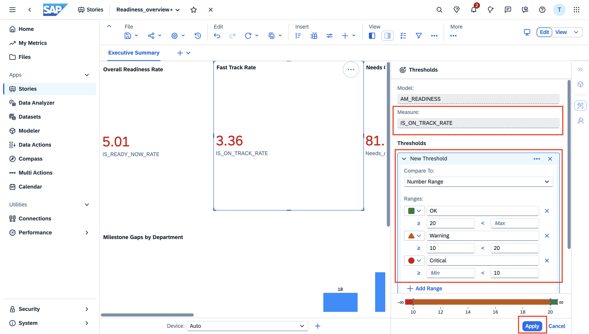

### Chart 3: Needs Coaching Rate
Create a Numeric Point chart widget with the steps mentioned above.
Name (ID): `NEEDS_COACHING_RATE`

Formula: ["AM_READINESS":IS_NEEDS_COACHING]/["AM_READINESS":HEADCOUNT]*100

- Title: Needs Coaching Rate

 

### Chart 4: High Potential Individual Rate
Create a Numeric Point chart widget with the steps mentioned above.
- Name (ID): `HIGH_POTENTIAL_INDIVIDUAL_RATE`

- Formula: ["AM_READINESS":IS_HIGH_POTENTIAL]/["AM_READINESS":HEADCOUNT]*100

- Title: High Potential Individual Rate

 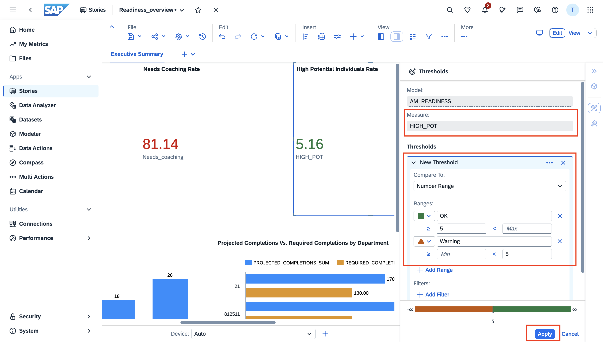

---

### Insert a Donut Chart Widget
1. Make sure you are on the Builder tab.
2. Add a new Chart and select type as **Donut Chart**.
3. Resize it to occupy roughly one-sixth of the page width on the fifth and sixth spot.
4. For each of the donut charts, add the measure and dimension.

 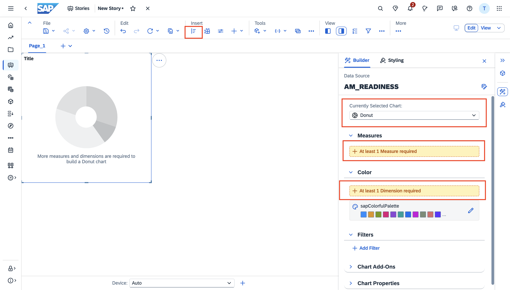  

> **Note:**
> You will repeat this insert step for each of the 2 donut chart tiles below. Place them side by side in a single row across the full page width in the fifth and the sixth spot. Let us see in the next steps how to create each of the two KPIs tiles.

### Chart 5: Milestone Status Breakdown
- Title: Milestone Status Breakdown
- Measure: `READINESS_TIER_RANK`
- Dimension: `DEPT_MILESTONE_STATUS`

 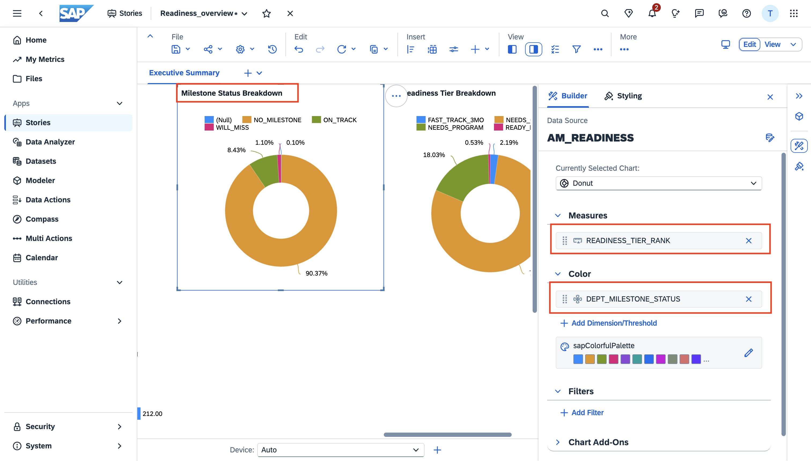  

### Chart 6: Readiness Tier Breakdown
- Title: Readiness Tier Breakdown
- Measure: `READINESS_TIER_RANK`
- Dimension: `READINESS_TIER`

 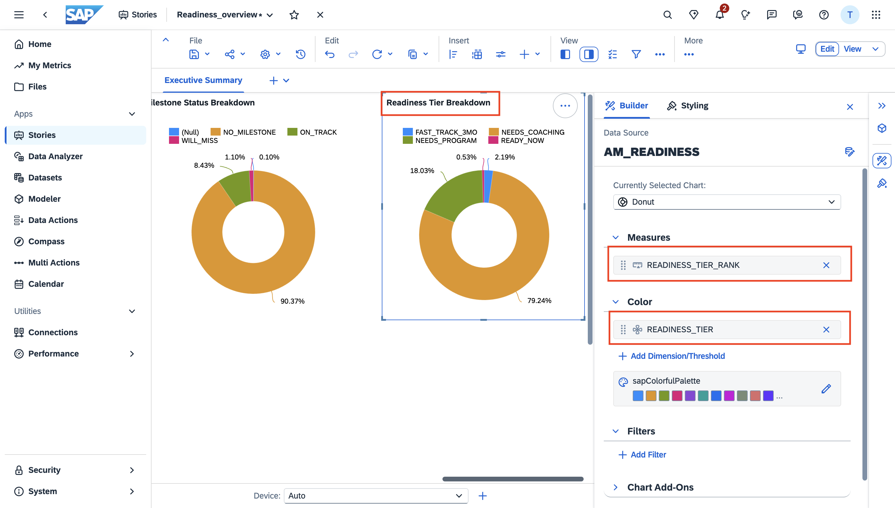  

---
### Insert a Bar Chart Widget
1. On the second row, add a new **Bar Chart** from the Builder tab.
2. Set the chart type to `Bar/Column`. Set the Chart Orientation to either Vertical or Horizontal.
3. For each of the bar charts, add the measure and dimension.

 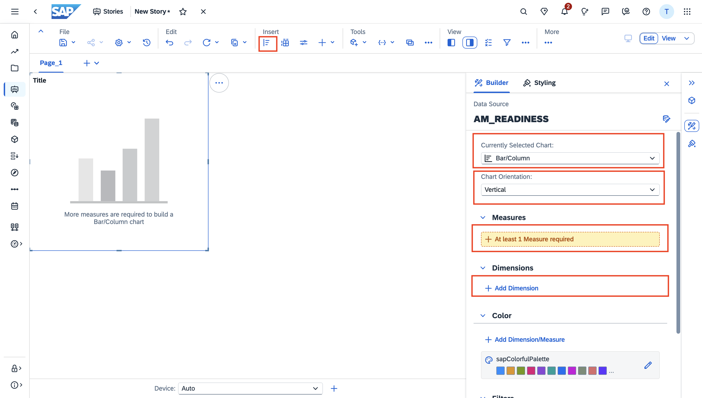  

### Chart 7: Milestone Gaps By Department
- Title: Milestone Gaps By Department
- Measure: `MILESTONE_GAP`
- Dimension: `DEPARTMENT`
- Chart Orientation: `Vertical`

### Chart 8: Projected Completions (12Mo. Projection) Vs. Required Completions
- Title: Projected Completions Vs. Required Completions
- Measure(s): `PROJECTED_COMPLETIONS_SUM`, `REQUIRED_COMPLETIONS_SUM`
- Dimension: `DEPARTMENT`
- Chart Orientation: `Horizontal`

---

## Explore Smart Insights in SAC: OPTIONAL

To make the dashboard interactive, add **Smart Insights**. 
Smart Insights is an augmented analytics feature in SAP Analytics Cloud that automatically explains why a specific data point or variance looks the way it does — surfacing the key drivers behind a value using statistical analysis, presented as a combination of natural language text and a supporting chart.

1. Open the story in View or Edit mode.
2. Click on the Donut chart **Milestone Gaps By Department**.
3. From the context menu, select Smart Insights.
4. The Smart Insights panel opens on the right side, showing:
      - A text explanation of the top contributors to that value
      - On collapsing the insights, a visualization (e.g. ranked bar chart) showing which dimension members are driving the result is also depicted.
5. Use the smart insights feature on other charts as needed to gather further understanding.

 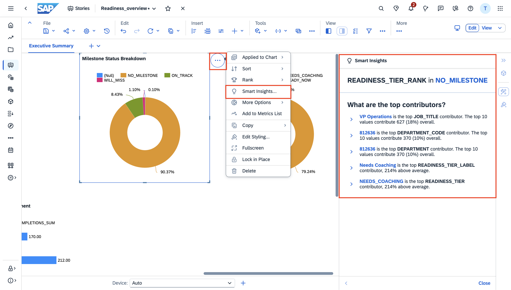  

 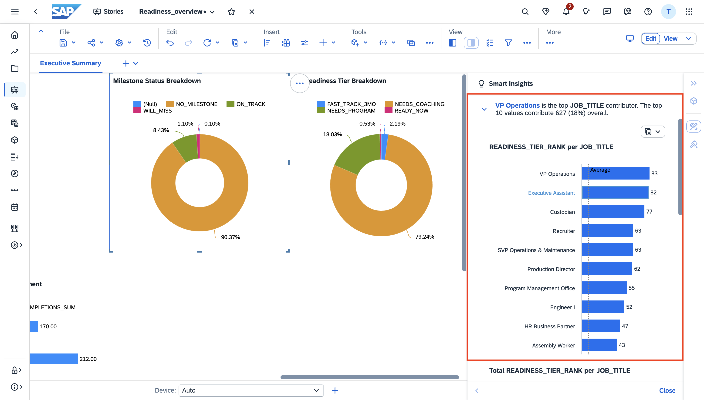  

>What It Tells You

| Question | What Smart Insights surfaces | 
|---|---|
| What are the top contributors to this value? | Dimension members ranked by influence  | 
| How has this changed?	 | Deviation from average or benchmark| 
| What is pulling this value up or down?|Positive vs. negative contributors |
| How is this calculated?|Breakdown of the measure's components|

## Congratulations!
You have now run an end-to-end use case of converting business data into valuable insights.