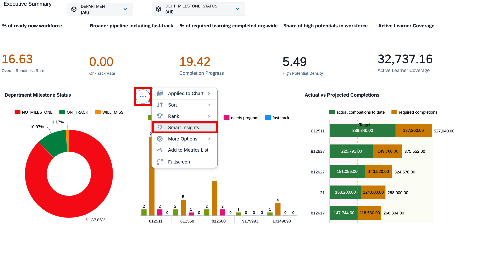
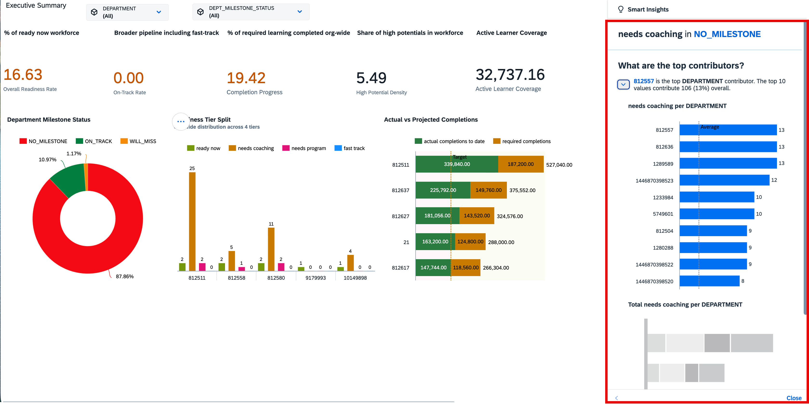

# Creating a Story in SAP Analytics Cloud — Employee Readiness vs Forecast

## Overview

In this exercise, we will build the **Employee Readiness vs Forecast** dashboard in SAP Analytics Cloud. The story tracks workforce readiness levels and learning completion progress across departments and milestone statuses.

A Story in SAP Analytics Cloud is a reporting and visualization tool that allows users to analyse data through charts, tables, filters, and interactive dashboards. Stories can be created using imported or live data models and can be shared across the organization. The end result of this exercise will be as below.

 

## Prerequisites

Before creating a story, ensure that:

- You have access to SAP Analytics Cloud. URL: (TODO)
- A data model is available and accessible (built in the previous exercise)
- You have the required permissions to create and save stories.

## Create Story and Import Model

### Step 1: Create a Canvas Story

 
1. From the SAC home screen, select **Stories**.
2. Click on **Canvas**.

### Step 2: Change Page Title
1. Change the Page title as shown below: 

 

### Step 3: Select a Model or Dataset
1. Search for your Model or Dataset in the `SAPSRC` folder and select it.  
 
 

2. Once the data is now connected to the story, Drag & drop **Chart** under **Widget** into the canvas. 
 

3. In the next sections, we will create the KPI tiles and charts that make up the Executive Summary page. 

---

## Create KPI Tiles — Executive Summary

The top row of the dashboard contains **four Numeric Point (KPI) widgets** that display the most critical readiness metrics at a glance.

 

### Insert a Numeric Point Widget

1. Make sure you are on the Builder tab.
2. Select **Numeric Point**.
3. Resize it to occupy roughly one-sixth of the page width.

 
> **Note:**
> You will repeat this insert step for each of the five KPI tiles below. Place them side by side in a single row across the full page width. Let us see in the next steps how to create each of the KPI tiles.

---

### Chart 1: Overall Readiness Rate

### Chart 2: Fast Track Rate

### Chart 3: Needs Coaching Rate

### Chart 4: High Potential Individual Rate

---

### Insert a Donut Chart Widget
1. Make sure you are on the Builder tab.
2. Select **Donut Chart**.
3. Resize it to occupy roughly one-sixth of the page width on the fifth spot  
 

4. We will add one more donut chart on the top row

### Chart 5: Milestone Status Breakdown

### Chart 6: Readiness Tier Breakdown

---
### Insert a Bar Chart Widget
1. One the second row, add a new **Bar Chart** from the Builder tab. 
 

### Chart 7: Milestone Gaps By Department

### Chart 8: Projected Completions (12Mo. Projection) Vs. Required Completions

---

## Explore Smart Insights in SAC

To make the dashboard interactive, add **Smart Insights**. 
Smart Insights is an augmented analytics feature in SAP Analytics Cloud that automatically explains why a specific data point or variance looks the way it does — surfacing the key drivers behind a value using statistical analysis, presented as a combination of natural language text and a supporting chart.

 

1. Open the story in View or Edit mode.
2. Click on the Donut chart **Department Milestone**.
3. From the context menu, select Smart Insights.
4. The Smart Insights panel opens on the right side, showing:
      - A text explanation of the top contributors to that value
      - A visualization (e.g. ranked bar chart) showing which dimension members are driving the result

 

>What It Tells You

| Question | What Smart Insights surfaces | 
|---|---|
| What are the top contributors to this value? | Dimension members ranked by influence  | 
| How has this changed?	 | Deviation from average or benchmark| 
| What is pulling this value up or down?|Positive vs. negative contributors |
| How is this calculated?|Breakdown of the measure's components|

## Congratulations!
You have now run an end-to-end use case of converting business data into valuable insights.